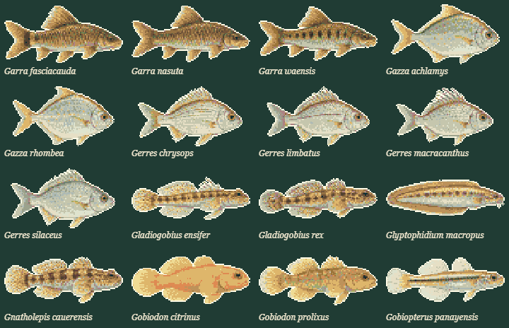

# LCD species artwork

The built-in ImageGen editor produced the original ten specimen plates from the original game palette. The brief called for a whole, right-facing natural-history sprite, species-specific anatomy, fins and markings, and a single cream contour. The collectible ray uses a dorsal view. The eight fictional species have original designs.

The plate order matches the stable 52 original field-guide IDs, followed by the eight fictional species and sixteen additional family illustrations. The first 60 specimens retain their individual artwork. New individual plates use the owner's reference `plate-2.png`. The row-major plate manifest in `field/plates.json` maps each painted fish to a stable catalog ID. Run `node game/art-source/compile-field.cjs` to compile the field plates. The browser and the handheld decode the same 96 × 50 pixels and RGB565 colors. Catalog entries awaiting individual art display an empty field-note symbol. These are game illustrations and their markings have not been validated as taxonomic identification keys. The original PNG plates remain in the private design source. Only the packed sprites ship on the handheld.

Run `node game/art-source/compile.cjs` from the repository root after installing the existing game/lan dependencies. The compiler samples 96 × 50 pixels per specimen and supplies matching 4-bit indices and 16-color RGB565 palettes to the simulator and handheld. The 60 original frames and palettes use 145,920 bytes before compiler alignment. The web journal downsamples each frame for its 48 × 25 thumbnails.

The approved style reference is [plate-2.png](plate-2.png) with SHA-256 `db148c706403da2e3c49aa2a8c51979de31055d025e188b299ddb547a352c2fe`. Each new sheet is generated with the original reference and the exact scientific names in manifest reading order. The compiler isolates connected specimens across the full transparent sheet to retain fins that cross grid lines, normalizes to a shared LCD palette, and packs only the bounding rectangle. The browser and device read the same packed pixels.

## Portrait coverage and review

The [catalog artwork register](coverage.csv) lists the source sheet and cell for each individual portrait. Run `python game/art-source/coverage.py` after changing the catalog or plate assignments. The 0.9.3 render audit found 456 unique images and silhouettes among 2,545 entries, including eight fictional designs. The other 2,089 entries have a field-note marker. Species names in the manifest identify the intended subjects. Anatomical review remains open.

Some source PNGs contain a pale paper background. The compiler removes edge-connected paper and isolates each subject before palette reduction. The game renders index zero as transparent. The preview below uses the actual game decoder on a uniform green background. On cell 14, the yellow lemon coralgoby needs more legible blue face bars. [Museum species account](https://fishesofaustralia.net.au/home/species/131)

The [recovery catalog](../content/salvage.json) assigns habitat and hauling effort to twelve separately painted finds. Run `node game/art-source/compile-salvage.cjs` after editing the source plate or catalog. Its LCD atlas is shared by the simulator and firmware.
