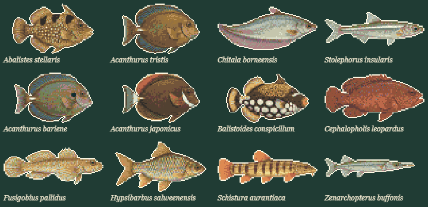
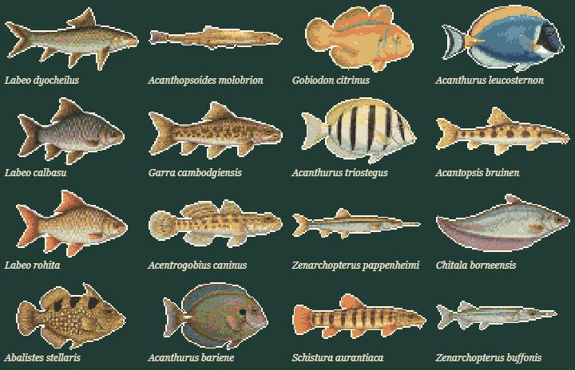

# LCD species artwork

The built-in ImageGen editor produced the original ten specimen plates from the original game palette. The brief called for a whole, right-facing natural-history sprite, species-specific anatomy, fins and markings, and a single cream contour. The collectible ray uses a dorsal view. The eight fictional species have original designs.

The plate order matches the stable 52 original field-guide IDs, followed by the eight fictional species and sixteen additional family illustrations. The first 60 specimens retain their individual artwork. New individual plates use the owner's reference `plate-2.png`. The row-major plate manifest in `field/plates.json` maps each painted fish to a stable catalog ID. Run `node game/art-source/compile-field.cjs` to compile the field plates. The browser and the handheld decode the same 96 × 50 pixels and RGB565 colors. A handheld without matching art media marks card-dependent portraits in the journal and draws new catches from resident artwork. These are game illustrations and their markings have not been validated as taxonomic identification keys. The original PNG plates remain in the private design source. The handheld decodes packed sprites from application flash and the versioned field-art card.

Run `node game/art-source/compile.cjs` from the repository root after installing the existing game/lan dependencies. The compiler samples 96 × 50 pixels per specimen and supplies matching 4-bit indices and 16-color RGB565 palettes to the simulator and handheld. The 60 original frames and palettes use 145,920 bytes before compiler alignment. The web journal downsamples each frame for its 48 × 25 thumbnails.

The approved style reference is [plate-2.png](plate-2.png) with SHA-256 `db148c706403da2e3c49aa2a8c51979de31055d025e188b299ddb547a352c2fe`. Each new sheet is generated with the original reference and the exact scientific names in manifest reading order. The compiler isolates connected specimens across the full transparent sheet to retain fins that cross grid lines, normalizes to a shared LCD palette, and packs only the bounding rectangle. The browser and device read the same packed pixels.

## Portrait coverage and review

The [catalog artwork register](coverage.csv) lists the source sheet and cell for each individual portrait. Run `python game/art-source/coverage.py` after changing the catalog or plate assignments. The 0.9.4 register assigns a portrait to all 2,545 entries, including eight fictional designs. Each manifest cell identifies the intended species. The register distinguishes source-matched corrections, illustrated design review and pending taxonomic review.

Some source PNGs contain a pale paper background. The compiler removes edge-connected paper and isolates each subject before palette reduction. The game renders index zero as transparent. The preview below uses the actual game decoder on a uniform green background. The original cell 14 prompted a review of the yellow lemon coralgoby’s blue face bars; the current single-species replacement uses an identified photograph. [Museum species account](https://fishesofaustralia.net.au/home/species/131)

The [recovery catalog](../content/salvage.json) assigns habitat and hauling effort to twelve separately painted finds. Run `node game/art-source/compile-salvage.cjs` after editing the source plate or catalog. Its LCD atlas is shared by the simulator and firmware.

## Field-art card

The compiler binds each plate cell to a stable catalog ID. A single-species replacement has its own source file and SHA-256 in the same manifest record. The style reference remains the original plate 2. For new plates, the generation brief named each adult species in row-major order and requested a complete side profile, species-specific morphology and markings, individually drawn fins, warm highlights and a thin pale contour on transparent paper. Rays use dorsal views. The Brahmaputra labeo brief included the projecting snout, inferior mouth, gently arched back and forked tail described by the [College of Fisheries, Central Agricultural University](https://cofcau.ac.in/sites/default/files/2024-07/Database_of_NE_Fishes.pdf) and [Zoological Survey of India](https://faunaofindia.nic.in/PDFVolumes/occpapers/183/index.pdf).

The compiler writes one index, per-species RGB565 palettes, resident pixels, and the additional packed bytes in `game/assets/TW-FISH.BIN`. The standalone page includes those bytes inline for offline use. The firmware package carries the same bytes under `sdcard/TW-FISH.BIN`. Copy the file to the top level of a FAT-formatted microSD before starting the handheld. The loader verifies length and SHA-256 before publishing the PSRAM copy. An absent, incompatible or unreadable card leaves the resident selection active. The journal and its saved catalog IDs stay in their original partitions. Installed portraits determine which species may appear in new encounters.

The current Brahmaputra labeo was repainted to the proportions of McClelland’s [original plate XXXVII, figure 1](https://archive.org/details/indiancyprinidae00mccl/page/n110/mode/1up). Its body depth, measured clear of the fins, is approximately 26% of standard length in the working illustration. The full [image credits](../content/specimen-image-credits.csv) accompany the browser and USB releases.

The [comparison ledger](reference-review.csv) records the 277 exact-name reference sources reviewed at sprite scale. Availability of usable reference images determined the sample. Reviewers checked gross anatomy and visible markings. Identification detail in other species remains open. The two review passes led to 29 individually source-matched corrections. A separate eel review replaced 12 illustrations to restore complete tapering tails and the appropriate body form. The image credits specify the original creators, licenses and modifications for reused material.
