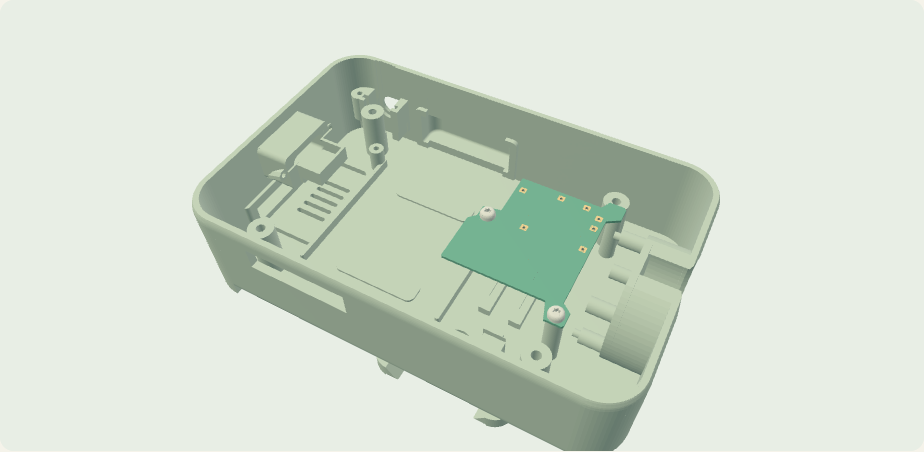

# Case-mounted control and USB board R0001

The [seven-plate X1C print review](../../mechanical/reel-dfm-r0001/README.md) carries forward this housing and gauge and includes the reinforced reel and updated rod-grip process.

The rear shell now carries one custom PCB that combines A4 audio, sensor-bus and power-key circuitry with A5 USB input protection. Two screws locate the board on integral PETG posts. A third integral rest supports the free edge. The Waveshare module mounts independently on its original enclosure points. This removes six loose spacers and twelve adhesive joints. The product still has separate sensor, haptic and indicator hardware at their functional locations.

**Ready for an unpowered fit print.** The electrical assembly is under engineering review. The two-piece fit kit is TW-A-0003-R0001. The board layout is TW-P-0034-R0001; its population and BOM are registered together as TW-A-0004-R0001.

[Download the two-plate Bambu Studio project](https://github.com/natthapolvanasrivilai/thai-waters-handheld/releases/download/case-board-r0001-fit-1/Case-board-R0001-X1C-fit.3mf) · [Download the interactive offline assembly view](https://github.com/natthapolvanasrivilai/thai-waters-handheld/releases/download/case-board-r0001-fit-1/Case-board-R0001-view.html) · [Housing, board, screws and three power leads in STEP](case-mount-assembly.step) · [Populated PCB in STEP](case-board.step)

## Fit the two printed parts

1. Print plate 1 for the rear housing and plate 2 for the 0.8 mm PCB outline gauge. The project preserves the X1C housing profile, USB support blocker and local layer heights. The new gauge checks the board perimeter and holes. The populated components are visible in the 3D view.
2. Let the plate cool. Check that both blind pilots are open and that all three bearing surfaces are clean. Viewed through the open case, the long stepped post clears the edge of the haptic board. The third support has a solid top.
3. Lower the gauge with its two offset holes over the pilots. Check that it sits on all three surfaces without rocking or needing sideways pressure. The real PCB will sit with its components facing the floor and screw heads toward the display.
4. Use the two M2 × 4 T6 screws listed in the BOM for the trial. The nominal pilot is 1.64 mm, 4.50 mm deep. The screw engages 3.20 mm below the board. Assess thread fit on spare printed stock first. Stop if a post twists, whitens or cracks. Tighten only enough to seat the gauge.
5. Offer the display to its original mounts with the unit unpowered. The board and bracket should stay seated when the display is lifted. Check for a screw-head witness mark, a rocking gauge, pinched wires or pressure on the screen. The old display gauge with six projecting spacer seats represents the superseded stack and can give a false interference here.

## Mechanical evidence

The PCB is 32.8 × 38.2 mm at its widest extents and 0.80 mm thick. The seat is at installed Z17.70 mm. Board holes are 2.30 mm diameter. The model uses the two M2 × 4 catalog-standard screw solids and the original registered R0017 housing geometry. The rear shell retains the USB side slot, power-key opening and battery bay. The section of the second post that passes the haptic board is offset 2.5 mm; its sloped transition grows over 5 mm of height.

| Nominal check | Result |
|---|---|
| Seated board, both screws, three supports and three revised wire jackets | No unintended solid overlap with tested installed parts. A small copper intersection at J8 is the modeled solder-tail termination. |
| Lower populated board 32 mm into the open housing | 0.74 mm calculated clearance bound to preinstalled parts outside the intentional seats. A straight 4 mm driver shank clears by at least 1.82 mm. |
| Unlatch CviLux and withdraw 8.25 mm with the registered loom fixed | Lower bounds relative to the changed parts are 0.508 mm for rigid parts and 0.869 mm for flexible jackets. The limiting rigid pair is the plug assembly and PCB near full withdrawal. |
| Lift rigid display 18 mm after disconnecting leads | At least 0.30 mm nominal calculated clearance bound to the new mounts and PCB. The second screw head limits this check. |
| Maximum drawing-size pack | Nearest new part is the second post at 1.20 mm. |
| X1C toolpaths | Both plates sliced. All three supports have model material across 81 inspected layers. Both pilot passages are open in the upper shaft. Plate 2 has four layers. |

The motion bounds include motion between samples and a mesh allowance. Dimensions, screw-head tolerances, springback, post strength and post-removal damage need checking on a physical print. The computed clearances to the changed parts supplement the [baseline connector checks](../../mechanical/TW-A-0001-R0013/README.md). [Seated fit](fit.json) · [Insertion and driver access](insertion.json) · [Service motion](motion.json) · [Slicer evidence](toolpaths.json)

## Circuit and harness

[Editable KiCad project](case-board.kicad_pro) · [Schematic PDF](schematic.pdf) · [Routed PCB](case-board.kicad_pcb) · [Parts and mounting BOM](bom.csv) · [Review Gerbers and plated drills](layout-review-plots.zip)

The board has 29 nets and 94 footprint pins. ERC, DRC, unrouted and schematic parity reports each have zero findings at their configured warning/error thresholds. An independent comparison against both source schematic netlists checks every pin, including the protected power return. A4 references retain their numbers. A5 component and land references add 100. Bare solder lands contribute copper and holes; they carry no purchased connector body.

| Board connection | Assembly meaning |
|---|---|
| W101, W104, W105 | V2 USB entry at LRC4-1, CC1 at R26-2 and CC2 at R24-2 respectively. The supplier schematic identifies the nets. Landing coordinates, solder access and routing require the actual PCB or an editable supplier layout. |
| W102 and J8 on the custom board | Same protected PMIC node; this returns to Waveshare J8 pin 1. Only the protected return feeds the power key. No extra parallel feed from raw USB. |
| W103 and custom J11/J12 | Ground return. W103 terminates at the existing ground tap. |
| W106 and W107 | W106 stays empty. W107 feeds the USB indicator resistor carrier. |
| Custom J1–J7, J9–J13 | Speaker, bus, battery and power-key functions follow the [controls harness pin map](../pcb-r0004/harness.csv). The four audio lands move 6 mm toward the case center. The published legacy XY positions are superseded by the new layout. |

W102, W103 and W107 have revised wire, copper and board-end solder geometry. The three routes leave their registered far ends fixed. The smallest modeled bend radius is 0.415 mm. Dressing, strain relief and flex life need physical evidence. These three leads still tether the halves. A complete removable display loom, including the three unlocated V2 taps and revised audio leads, remains open. The CviLux release check exercises the separate haptic plug.

The USB replay uses copper lengths extracted from this board in 73 ngspice cases, including eight with the power key connected directly to the protected supply. Of 205 measurements, 191 met limits, five characterize operation and seven are deliberate fault detections. **Two 330 mA startup measurements without a battery missed the 3.9 V floor** (approximately 0 V and 0.63 V). This board carries forward the protected, low-current input. Batteryless startup, dead-pack recovery, real charge current and thermal behavior are unresolved. The key sweep produced 84 expected operating results plus one deliberate open-lead failure on its rail-source fixtures. [ERC](erc.json) · [DRC and parity](drc.json) · [USB measurements](measurements.csv) · [Solver decks and logs](decks-and-logs.zip) · [Power-key measurements](key-corners.csv)

## Rebuild the evidence

Run `build.py` to regenerate the schematic and copper from the registered parents. In KiCad 10, export the schematic netlists in KiCad XML format and run `parts.py controls.xml combined.xml`. Export the board STEP with `--user-origin=100x100mm --subst-models --include-pads` and the standard KiCad model libraries. Replay USB with `circuit.py PATH_TO_NGSPICE`.

With CadQuery, run `fit.py CACHE --registered-step R0017-DRESSED.step`, followed by `motion.py CACHE` and `insertion.py CACHE`. The first check verifies the released STEP hash and extracts local assembly members. Run `print_fit.py`, slice both plates with Bambu Studio, then run `toolpaths.py SLICED_OUTPUT_DIRECTORY`. Run `viewer_build.py` with the project’s Three.js dependencies installed for the standalone offline viewer.

[Current handbook](../../../docs/wiki/Current-status.md) · [Earlier blank-board study](../../mechanical/case-mounted-board-study/README.md) · [Mount qualification issue](https://github.com/natthapolvanasrivilai/thai-waters-handheld/issues/100)
