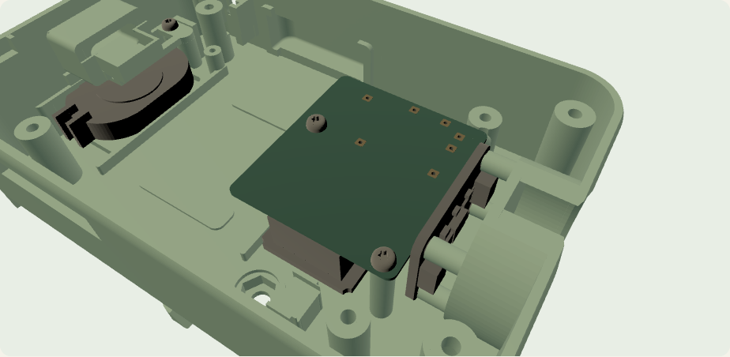

# Rectangular control and USB board R0002

[Open the offline 3D mount review](Mount-review.html) · [Print the board gauge](Case-board-R0002-PolyTerra-SuperTack-X1C.3mf) · [Editable KiCad layout](case-board.kicad_pcb) · [Populated PCB STEP](case-board.step) · [Housing STEP](housing.step) · [Mounted assembly STEP](case-mount-assembly.step)

The combined control and protected-USB board has a 32.4 × 35.8 mm rectangular outline, four R1.5 mm corners and two 2.30 mm holes inside the perimeter. Its component side faces the case floor. The screw centers and seat height match the R0008 case. The revised housing brings the far support under the corner. Its upper contact with the new gauge increases from 1.62 mm² on R0008 to 7.55 mm². The sloped section on the second screw post clears the existing haptic hardware. Both M2 × 4 screws remain accessible from above.

In the interactive guide, **Lower boards** shows the installed assembly. **PCB underside** turns the populated board over. The labeled component positions come from the routed KiCad board. The wire lands are bare solder connections with no connector body. The guide uses inert representations for the other boards and does not display the revised W2 lead. Its installed path is included in the fit and clearance analysis.

## First physical check

Print the single gray gauge on the X1 Carbon with PolyTerra PLA, a 0.4 mm nozzle and SuperTack. The native slice has 12 model layers, 1.70 g of model filament and zero support. If you have an R0008 case, lower the gauge with the raised component blocks facing down. Start both M2 screws by hand. Check for rocking, inspect the nearby sensor and wire space, and offer the unpowered display to its mounts. The R0008 case can check the new board outline and hole pattern. Testing the larger corner bearing requires the revised housing. The [R0008 eight-plate enclosure project](../../mechanical/step-fit-r0008/README.md) is still the published full-case print. This revision issues a board gauge and editable housing for review.

## Engineering checks

| Check | Result |
|---|---|
| KiCad layout and schematic | All 50 footprints, 298 routed segments and 34 vias match the parent. Zero DRC, ERC, connectivity or schematic-parity findings. [Electrical comparison](electrical-check.json) · [BOM](bom.csv) |
| Seated fit and harness | Nominal installed solids clear the reworked supports and fixed leads. W2 has a new bend over the board edge, retaining both terminations. A modeled 0.00009 mm³ intersection at the W2 solder termination is intentional. [Static fit and lead routes](fit.json) |
| Lowering and tool access | A 32 mm drop has a 0.405 mm clearance lower bound. A 4 mm driver clears by at least 1.82 mm. [Insertion checks](insertion.json) |
| Unlatch and withdraw with the display seated | Over the 8.25 mm service stroke, lower bounds are 0.509 mm at the rigid plug and 0.441 mm at the flexible jacket. The former board gave 0.870 mm at the jacket. Check that the VCC branch passes the new edge freely on a populated unit. [Service sweep](motion.json) |
| Display and maximum pack | The 18 mm rigid display lift has a 0.30 mm clearance bound. The maximum pack has 1.20 mm nominal clearance to the changed parts. [Motion report](motion.json) |
| Printed gauge | Native toolpaths cover all 12 layers and both pilot cores stay open through the substrate. The source STEP fits the old and revised cases in CAD. [Gauge and opening checks](gauge-check.json) |

The populated assembly still needs physical verification. The two earlier batteryless startup failures remain open on the same circuit. The new shell has undergone CAD and assembly checks. A full-case slice and physical support-removal trial are pending for its revised posts. [Parent circuit results](../case-board-r0001/verification.json)

### Rebuild

Run `layout.py` to change the board perimeter. Use KiCad 10 with the project libraries and export STEP with the user origin at 100 × 100 mm, model substitution and pads included. Run KiCad DRC with schematic parity, ERC, then `electrical_check.py`. In the project CadQuery environment run `mount.py`, `gauge.py` and `guide.py`. Run `verify.py static CACHE`, `verify.py insertion CACHE` and `verify.py service CACHE` against the registered BREP cache used for the parent fit. Verify the separately reopened, sliced gauge using `gauge_check.py SLICE_DIRECTORY`. The housing source for this revision is the registered R0008 editable STEP.
