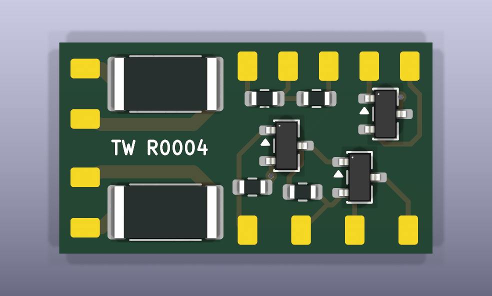

# A4 harness interposer for TW-A-0002-R0004

A4 carries the speaker attenuation resistors, the permanent I²C pull-ups and the autonomous remote power key. Its 13 surface-soldered wire lands connect to the A1 controller and the existing harness. The original J7 battery connector, J9 speaker plug and K3 switch stay available. Use the [editable KiCad project](harness.kicad_pro), [circuit drawing](circuit.pdf), [wire schedule](harness.csv) and [population BOM](bom.csv) together.



## Fabrication and assembly

The [engineering fabrication archive](harness-fab.zip) contains eight Gerber layers, the job file and metric Excellon. Fabricate the 23.00 × 13.00 mm outline on the Edge.Cuts centerline using 0.80 mm finished FR-4, two 35 µm outer copper layers, solder mask both sides and lead-free solderable finish. Plate the two Ø0.30 mm via holes. The back has no component lands or mask openings. Apply the top paste stencil to the 21 component pads. J1–J13 are integral 1.8 × 1.2 mm hand-solder lands. The quoted power rating for R1/R2 depends on local temperature and heat transfer into mounted copper. [Vishay rating conditions](https://www.vishay.com/docs/20035/dcrcwe3.pdf)

1. Orient the board component-side up with the four speaker lands at the left. R1 is the upper 2512 and R2 the lower. Across the top, R3 and R4 run left to right. At the bottom center R5 and R6 run left to right. D1 is the upper-right SOT23, Q1 the center device and Q2 the lower-right device. Their pin-1 markers sit to the left of their two-pin sides. Compare with the [placement coordinates](placement.csv).
2. Identify each controller net on the unpowered received A1. This layout uses the Waveshare V2 schematic. Record the controller revision. The published hardware tree supplies the V1/V2 schematics but omits production copper, board test points and controlled rework geometry. The [K3 contact drawing](../rev-f-power-key.md) distinguishes its raw switch contact from PWRON across R38. [Waveshare V2 schematic](https://github.com/waveshareteam/ESP32-S3-Touch-LCD-3.5B/blob/main/hardware/schematic/ESP32-S3-Touch-LCD-3.5B-V2-Schematic.pdf)
3. Retain the matching A1 J9 plug on the J1/J4 pair. Connect the free J2/J3 pair to the Adafruit 3923 speaker and trace polarity to its marked terminals. The two BTL legs float. At the loose A4, measure 4.99 Ω ±1% from J1 to J2 and from J4 to J3 after subtracting lead resistance. Check isolation of the two channels and ground. Normal speaker current passes through the resistors downstream of J9. A short at J9 or on the short input pigtail bypasses them. Its protection depends on the OEM PA. [Existing speaker specification](../usb-status-r0003/README.md)
4. Attach J5/J6/J7 to the fixed A1 end of W1. J8-27 on A1 is SDA, J8-31 is switched 3V3 and J8-25 is SCL. Retain W1 continuity to the encoder and W4 branch. Remove R1/R2 on the **A3 Boardoza board** and photograph the empty lands. With A4 isolated, measure 1.50 kΩ ±1% on each pull-up. Audit the assembled bus for fixed or accessory pulls and scope it at the furthest target. [Bus population and rise-time criteria](../integration-r0004/README.md)
5. A4 J8 receives A1 J8-1 raw USB VBUS. A4 J9 receives A1 J8-2 protected VBAT. Verify the two sources at their actual header positions before attaching the wires. On an A1 spin the J8-1 takeoff must remain upstream of the input limiter. D1 combines those two supplies only for the key gate network. J10/J11 go to the two remote SW1 contacts. J12/J13 go to the existing A1 K3 ground and raw switch contacts. Remove W3's previous direct raw-contact path. Leave R38 and K3 fitted. [BAV170 pinout](https://assets.nexperia.com/documents/data-sheet/BAV170.pdf) · [PMV65XP](https://assets.nexperia.com/documents/data-sheet/PMV65XP.pdf) · [PMV16XN](https://assets.nexperia.com/documents/data-sheet/PMV16XN.pdf)
6. Use the existing pigtails for the speaker and fine-stranded insulated leads for low-current signals. Preserve conductor identity at both ends. Lay the tinned conductor flat along each wire land with its jacket at the board edge. Keep all exposed strands within the pad and support each jacket off the solder joint. The simulation does not specify a physical cut length. Check jacket dimensions, anchor retention, removal stroke and clearance with the complete closed unit. The [populated STEP](harness.step) contains package models and copper. Its local bounds are X 0–23 mm, Y 0–13 mm, Z −0.035–1.995 mm. The STEP Y coordinate is 13 minus the Y value in the wire schedule.

## Verification

KiCad 10.0.8 reports zero ERC issues, zero PCB DRC errors or warnings, zero unconnected items and zero schematic parity differences. The two plated vias carry KEY_AON between sides. Independent Gerber/Excellon readback recovers all 14 networks and all 34 component/terminal pads. Minimum different-net copper spacing is 0.275 mm and copper-to-profile spacing is 0.550 mm. The parser gives a syntax warning for the location of the absolute-coordinate G90 statement in KiCad's Excellon output. It reads both metric drill coordinates and checks each against annular copper on both sides. [ERC](erc.json) · [DRC and parity](drc.json) · [Artwork reconstruction](artwork-verification.json)

The key study ran 84 operating cases and one deliberate open-wire control using ngspice 33. The supply cases cover a 3.0 V or 4.2 V cell alone, 4.75/5.00/5.25 V USB alone and two simultaneous source combinations. Each runs with both OEM K3 sensing topologies, 0.2 Ω and 10 kΩ closures, a 10 GΩ released contact, and 0.05/0.90 V diode-knee assumptions. Maximum simulated PWRON is 0.03657 V pressed and minimum PWRON is 3.30 V released. The lowest pressed key rail is 2.09995 V. Maximum modeled active source draw is 68.53 µA. Opening the VBUS feed with the cell absent leaves PWRON at 3.30 V despite a pressed remote key. [Case readings](key-corners.csv) · [Summary and engine hash](key-summary.json) · [Decks and solver logs](key-solver.zip)

The piecewise source model uses 2 Ω forward series resistance and a reverse-current slope of 80 nA per 5.25 V. The 0.90 V knee takes its scale from the specified BAV170 limit at 1 mA and 25 °C. The actual forward drop at microampere current varies with temperature. The fixtures retain the earlier level-1 MOSFET models, 3.3 V sense rail and assumed 50 kΩ PMIC pull-up. Confirm the actual autonomous key drive when A1 is asleep, off, charging or on USB alone, along with long-press timing and reverse current into an absent source. EC-01, EC-07 and EC-08 still require physical measurements. [First-article fixtures](../integration-r0004/first-article.csv)

A4 has no connection to connector CC, PMIC VBUS downstream of the entry network, ESP reset, regulator compensation, display enables, recovery UART or USB D+/D−. Those interfaces require separate controller circuitry. Existing power-step limits require the rail capacitor close to the MCU ground return and the battery capacitor close to J7. Their attachment impedance cannot be established on the A4 leads.

## Replay

Open the project in KiCad 10 with its stock symbol, footprint and STEP libraries installed. The saved schematic is directly editable. The [layout generator](layout.py) uses KiCad's bundled Python and can recreate the placed, routed PCB and three CSV tables. Use the following commands from this folder, supplying the KiCad installation's footprint folder as `FOOTPRINTS`. The local `TW.pretty` library supplies the wire land.

```text
<KiCad Python> layout.py --footprints <FOOTPRINTS>
kicad-cli sch erc --exit-code-violations --format json -o erc.json harness.kicad_sch
kicad-cli pcb drc --schematic-parity --all-track-errors --exit-code-violations --format json -o drc.json harness.kicad_pcb
kicad-cli pcb export gerbers --layers F.Cu,B.Cu,F.Mask,B.Mask,F.Silkscreen,B.Silkscreen,F.Paste,Edge.Cuts --no-protel-ext -o fab harness.kicad_pcb
kicad-cli pcb export drill --excellon-units mm -o fab harness.kicad_pcb
kicad-cli pcb export step --user-origin 0x13mm --include-pads --include-tracks --cut-vias-in-body --no-extra-pad-thickness -o harness.step harness.kicad_pcb
python verify_artwork.py harness-fab.zip
python key_corners.py --engine <ngspice-33>
```

Zip the contents of `fab` at the archive root to check newly plotted files. The independent checker uses Gerbonara 1.5.0 and Shapely 2.1.1. The [netlist](netlist.csv) indexes the component pad on each electrical network.
