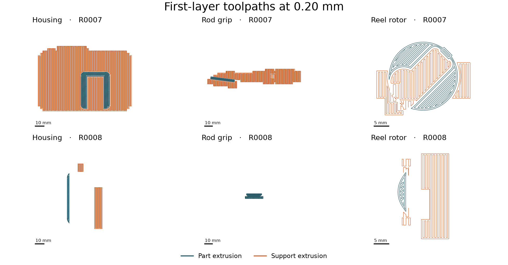

# Independent print and fit verification for TW-A-0001-R0008

All twelve device STLs and both inert gauge STLs have **zero measured downward surface area below 30° above the bed**, including elevated horizontal surfaces. The lowest off-bed downward facet is **32.367°** on the rotor. Bambu Studio still adds supports to the housing and rotor. The results qualify these files for an inert fit print. Physical fit, layer strength and dimensional repeatability await printed samples.

## What the slicer will print

The comparison uses one part per plate, its supplied orientation, 100% scale, Bambu Studio 02.08.02.61, an A1 with a 0.4 mm nozzle, Generic PETG, the 0.20 mm Standard process and textured PEI. Normal automatic support uses a 30° threshold and permits support on the model. Both comparison runs disable brims. A third run enables the specified outer brims. At this profile, the 14-part support estimate falls **65.4%**, from **13.9461 to 4.8241 g**. The taller orientations increase the sum of model print times from **4 h 35 min to 6 h 58 min**. The specified brims bring the candidate to **92.08 g** total and **7 h 00 min** across the individual plates. Printer preparation, plate changes and physical support removal take additional time.

| Part | Minimum downward angle above bed | Bare model bed contact, mm² | Old support, g | New support, g | Outer brim, mm |
|---|---:|---:|---:|---:|---:|
| Housing | 43.31° | 161.71 | 10.7539 | 4.4098 | 8 |
| Bezel | 44.56° | 2459.77 | 0.2211 | 0.0000 | 0 |
| Reel rotor | 32.37° | 31.26 | 0.5417 | 0.4143 | 5 |
| Folding stem | 45.00° | 2.36 | 0.2137 | 0.0000 | 5 |
| Reel grip | 42.93° | 6.85 | 0.0000 | 0.0000 | 0 |
| Collar | No off-bed downward facet | 67.44 | 0.0000 | 0.0000 | 0 |
| Power cap | No off-bed downward facet | 46.56 | 0.0000 | 0.0000 | 0 |
| Rod grip | 44.99° | 179.50 | 2.2028 | 0.0000 | 8 |
| West key-board retainer | 45.00° | 75.86 | 0.0000 | 0.0000 | 0 |
| Grip screw keeper | No off-bed downward facet | 53.14 | 0.0000 | 0.0000 | 0 |
| Receiver nut keeper | No off-bed downward facet | 46.56 | 0.0008 | 0.0000 | 0 |
| Battery wire bridge | 90.00° | 278.20 | 0.0000 | 0.0000 | 0 |
| PKCELL maximum body gauge | 45.00° | 2199.19 | 0.0121 | 0.0000 | 0 |
| Adafruit CAD gauge | 45.00° | 184.14 | 0.0000 | 0.0000 | 5 |

The housing has a 161.71 mm² landing strip and prints 94.52 mm tall. Its generated support reaches the rear grip receiver, the encoder lands and reel well, and smaller areas near the lead tunnel and key. The rotor support touches the outer rim and the recess-side face. Clear these regions before assembly. The folding stem has 2.36 mm² of bare bed contact and uses a 5 mm outer brim. The 130.4 mm rod grip uses an 8 mm brim. Inspect the cooled stem eye, rotor rim, guide surfaces and gauges after brim removal. The slicer estimates 0.5911 g of brim material across the set. [Sampled support contacts in assembly coordinates](support-locations.json) · [Specified-brim slice records](candidate-specified-brims.json)

## Geometry and fit

- Every STL has one connected, watertight body, consistent winding, positive volume, zero duplicate or zero-area triangles and a bed datum within 0.02 mm of Z0. The angle test uses the outward triangle normal. It excludes the coplanar bed contact within 0.01 mm and counts elevated flats separately. Rev G had 2,628.96 mm² of shallow sloping area and 6,012.56 mm² of elevated flat area across the same parts and gauges. Both totals are zero in R0008. The slicer can generate support for projected islands on otherwise acceptable slopes. Its bridge labels can also include spans over internal sparse infill. [Baseline and hashes](baseline-fdm.json) · [Candidate and hashes](candidate-fdm.json)
- An independent CAD-face audit inspected cylindrical axes and inward-facing arcs, plus curved surfaces with downward facets under 30°. Horizontal concave cylinder patches still describe side arcs and recess edges. No such patch retains a shallow round crown. The housing key counterbore, rod-grip screw seats and PKCELL gauge sockets use roof relief. The oblique stem and rotor orientations put their bores across multiple layers. The supplier gauge stands on its flat end. [Candidate curved-face inventory](candidate-curved-faces.json) · [Baseline curved-face inventory](baseline-curved-faces.json)
- Exact solid differences identify material added to the 12 device parts. Added volumes were tested against every other seated solid in the drawing assembly, catalog and alternate pack bodies, and each matching pair of lead models. No new overlap exceeds 0.002 mm³. The drawing and alternate battery gauges retain 0.50 mm to the mounting lands, and 0.65 and 0.95 mm respectively to the wire bridge. All three insertion corridors, 16 placement extremes and 15 key positions clear. The tightest factory lead-to-bridge clearance is 0.10 mm. The minimum separation between the modeled adapter wires is 0.4241 mm. These measurements use the specified insulation diameters and ideal rigid geometry. [Added and removed material](cad-changes.json) · [New seated contacts](new-contact.json) · [Battery and key results](battery-and-key.json)
- The display-to-bezel gap is 0.25 mm. The encoder sockets have 1.50 mm to the shell, the sensor package has 1.20 mm to the magnet and the rotor has 0.30 mm to the shell. The stem-to-grip clearance is 0.24 mm. Check real printed fits and as-received hardware before closing over a live cell. [Measured seated clearances](seated-gaps.json)

- Relative motion checks tested the added material during 15 key positions, 21 screw-retraction positions, 44 grip-slide positions, 19 crank-fold positions, and 36 rotor angles with the handle stowed and deployed. Across 6,082 moving/fixed pair positions, the peak new intersection was 0.00000 mm³. Four intentional stop tests still capture the locked screw, rail, end stop and keeper. Each produces at least 2.49757 mm³ of deliberate interference at the specified overtravel. Sample spacing limits the motion result between poses. [Motion and retention results](mechanism.json) · [Continuous rotor envelope and separate grip tests](../fit-verification.json)

## Reproduce

From the R0008 directory in the full repository checkout, use Python with CadQuery 2.8.0, NumPy, trimesh 5.2.1, SciPy, VTK and Matplotlib. Set `$slicer` to the Bambu Studio executable and `$archive` to the released Rev G dressed STEP gzip. Place scratch outputs in a writable directory outside the repository. The archive SHA-256 is checked by the fit script. The numeric evidence includes file hashes and all 14 parts. [Rev G source archive](https://github.com/natthapolvanasrivilai/thai-waters-handheld/releases/download/rev-g-fit-print/Riffle-Rev-G-dressed.step.gz)

~~~powershell
python QA/audit_prints.py baseline --slicer $slicer --work $scratch
python QA/audit_prints.py candidate --slicer $slicer --work $scratch
python QA/audit_prints.py candidate --specified-brims --slicer $slicer --work $scratch
python QA/audit_fit.py --archive $archive --cache "$scratch/assembly"
python QA/audit_surfaces.py baseline --cache "$scratch/assembly"
python QA/audit_surfaces.py candidate
python QA/support_locations.py $scratch
python QA/draw_first_layer.py $scratch
~~~

Each slicer run writes a G-code file and a native Bambu summary for every plate under the scratch directory. The support total includes support, interface and transition extrusion and agrees with the slicer's material accounting within 0.002 g per part. The contact mapper samples the interface paths and projects up to 1 mm to the STL to locate support-removal regions. No printer job was submitted.
