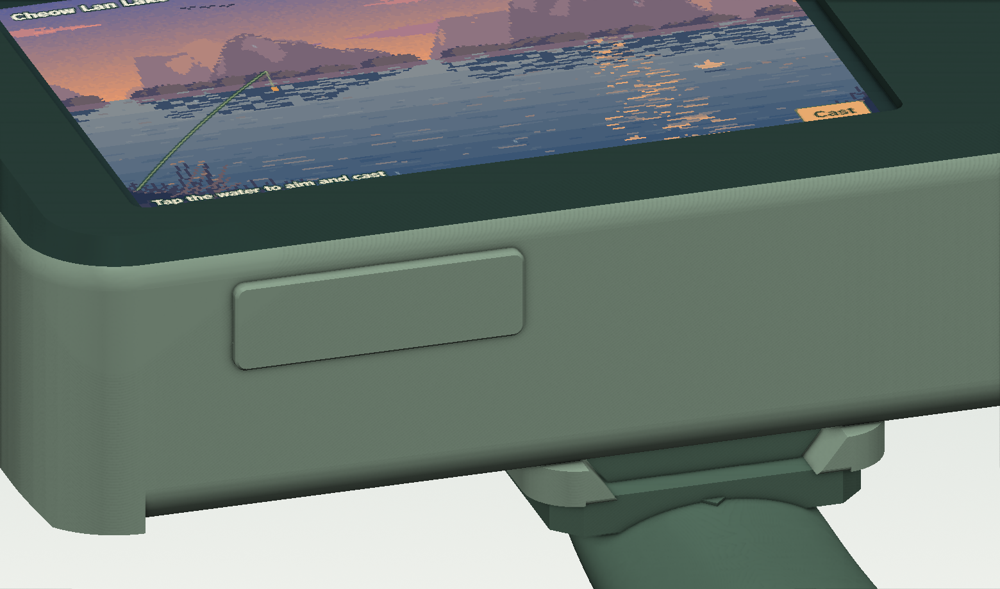

# R0010 handheld enclosure

TW-A-0001-R0010 adds a removable service-key cover, **P17 / TW-P-0027-R0001**, to the R0009 enclosure. The straight opening in the lower left edge gives a technician access to the original controller’s PWR, RESET and BOOT switches. The separate top key operates player power. The removable cover fits the existing housing, so an R0009 engineering unit can use the new print after a fit check. Record the fitted part and parent revision on its traveler. Electrical integration remains TW-A-0002-R0003.

| Installed interface | Verified in nominal CAD |
|---|---:|
| Bottom-wall pass-through | 26.00 × 6.00 mm through a 2.00 mm wall |
| Opaque TPU face | 28.80 × 8.80 × 1.20 mm |
| Face overlap on each edge | 1.40 mm nominal |
| Keeper engagement at each hook | 0.40 mm |
| Minimum distance to display assembly | 3.71 mm |
| Separation from the rod over its slide | ≥4.10 mm |
| Distance to the speaker cloth, rim or acoustic seal | ≥21.31 mm |
| Open access to each of three switch tips | Ø2.00 mm probe, 7.65 mm depth from shell |

The cover blocks the entire 156 mm² opening. Four independent hooks engage behind the wall. The left end has an undercut for a thumbnail. The exterior face has no apertures. The acoustic outlet is the separate rear grille over the speaker. The new cover does not enter its acoustic path. The CAD check and actual TPU slicer results accompany this revision. Pull force, wear, rattle, fit on printed housings and acoustic performance still require a physical first article.

- [Open service port, same camera](QA/service-cover-removed.png)
- [Print and service instructions](PRINT-GUIDE.md)
- [Opening, retention, component clearances and service paths measured from the exported STEP](QA/service-cover.json)
- [Per-part print evidence](QA/print-audit.json)
- [Dressed STEP round-trip results](export-verification.json)
- [Part and assembly membership register](../../revisions/README.md)

