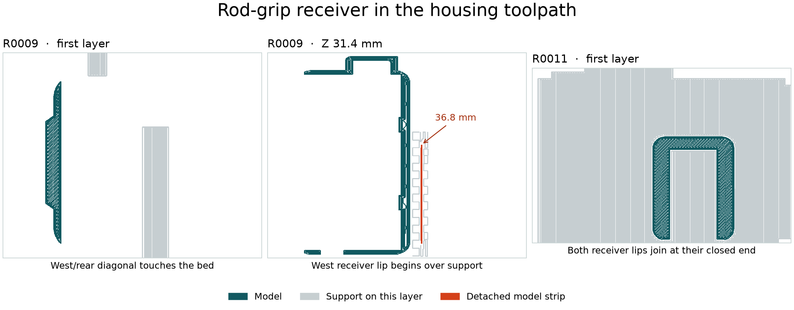

# R0011 receiver-down housing

Use **TW-P-0001-R0010** for the housing in the **TW-A-0001-R0011** enclosure set. The integral rod-grip receiver prints flat on its two lips and closed end. P17, the R0010 service-key cover, is included. The enclosure has 17 print positions and two separate inert battery gauges.

| Bambu Lab A1, 0.4 mm nozzle, 0.20 mm PETG | Previous diagonal build | Receiver down |
|---|---:|---:|
| First model layer, connected regions | 1 | 1 |
| Estimated deposited model footprint at Z 0.20 mm | 265.78 mm² on the west/rear bevel | 793.59 mm² across both lips and their closed end |
| Longest elevated model region starting without overlap on the model below | 36.8 × 0.6 mm at Z 31.4 mm | 5.8 × 2.1 mm at Z 14.2 mm |
| Build height | 94.52 mm | 31.00 mm |
| Support | 4.6037 g | 11.944 g |
| Total PETG and estimated model printing time | 48.92 g, 2h 41m 15s | 53.62 g, 2h 24m 47s |

The old strand maps to assembly X approximately −0.74 mm, Y −30.2 to +6.6 mm and Z −2.99 mm at the extrusion mid-plane. This lies on the west outer corner of the integral rod-grip dovetail. The exported G-code puts support interface under part of this strand. The new first-layer toolpath contains a single U-shaped footprint 35.7 × 45.3 mm across the two slide lips and stop. The longest additional elevated start is near the USB end of the housing. Inspect that detail when removing support.

First-layer area and connectivity use the vector union of extrusion footprints at their reported widths. The all-layer comparison rasterizes positive model extrusion using its reported width on a 0.10 mm grid. It samples arcs to a maximum 0.018 mm chord error and tests each layer's connected regions against the preceding model layer. Brim, supports, travel and purge are excluded from the footprint and connectivity test. Footprint areas are estimates. The housing uses the registered installed surfaces from R0009. Print orientation, adhesion, support removal, fit, fatigue and actual load capacity still require physical inspection and test.

- [Print preparation and first-article checks](PRINT-GUIDE.md)
- [Layer-by-layer disconnected starts, toolpath hashes and slicer settings summary](QA/housing-toolpaths.json)
- [Print mesh and slicer results for all 19 parts and gauges](QA/print-audit.json)
