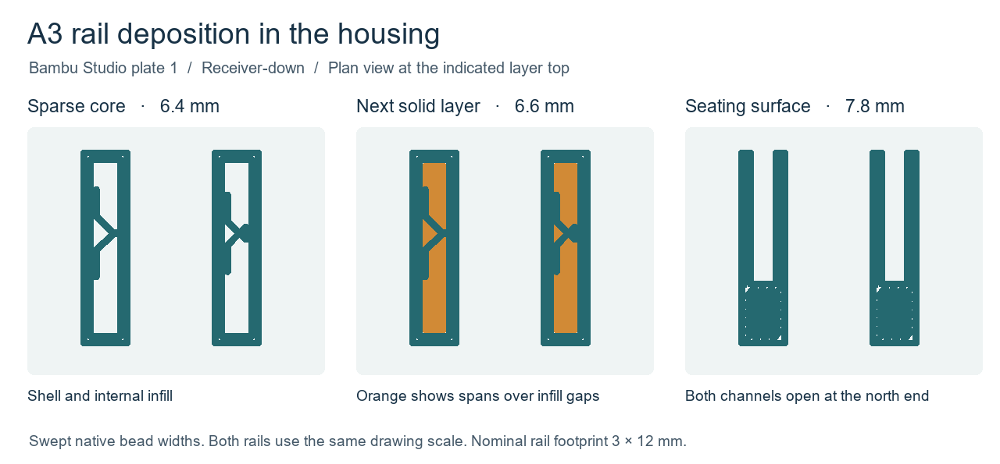

# R0014 housing and PCB fit prints

[Open the editable seven-plate X1 Carbon project](Thai-Waters-R0014-PCB-Fit-X1C.3mf) · [Identify the PCB gauges and six spacers](plate-7.png)

**For an existing R0013 fit kit, print only plate 1 to get the new housing.** Reuse the A3 board gauge and set aside the two loose A3 floor strips. The housing now supplies both seats. The other seven board gauges, three A4 spacers and three A5 spacers still fit the same kit. The R20 carrier and its floor sample remain a separate A2 trial.

Open the 3MF **as a project** in Bambu Studio, select the plate in Prepare and use **Slice plate**. Plate 1 keeps the receiver soles on the bed at the saved 100% scale. Use opaque PETG, a 0.4 mm X1C nozzle, 0.20 mm layers and the SuperTack plate. The sliced profile commands 255 °C nozzle and 70 °C bed with automatic normal support, a 30° support threshold and no housing brim. For a fresh set of board gauges, select **07 PCB fit gauges - R0014** and use the Engineering Plate with the same opaque PETG.

| Plate | Contents | Material and build surface | Native estimate |
| --- | --- | --- | ---: |
| 1 | Housing with the integral A3 seats | Slot 1 opaque PETG, SuperTack | 2 h 6 min · 53.93 g |
| 2 | Bezel and nine rigid enclosure parts | Slot 1 opaque PETG, SuperTack | 48 min · 10.02 g |
| 3 | Removable rod grip | Slot 1 opaque PETG, SuperTack | 2 h 22 min · 20.47 g |
| 4 | Three light guides | Slot 2 clear PETG, SuperTack | 8 min · 0.45 g |
| 5 | USB shield mask and service cover | Slot 3 TPU 95A, external feed, Textured PEI | 13 min · 0.84 g |
| 6 | Two alternative inert battery gauges | Slot 1 opaque PETG, SuperTack | 1 h 16 min · 14.02 g |
| 7 | Eight board gauges and six A4/A5 spacers | Slot 1 opaque PETG, Engineering Plate | 1 h 5 min · 26.66 g |

The three material slots address a single nozzle. Confirm the actual spool and physical plate for the selected job. The TPU profile commands 240 °C nozzle and 35 °C bed. The PETG plates use 255 °C and 70 °C. The project uses aligned seams and preserves the R0013 per-object support and brim settings. [Enclosure print setup](../../TW-A-0001-R0011/PRINT-GUIDE.md)

## Removing support and checking the seats

After cooling, remove the housing support from the outside and through the open housing. At the west USB end, support the small ledge while clearing material from beneath it. In the open case, both A3 bearing surfaces and their two narrow channels should be visible and free of strings. Dry-seat the board gauge directly on both rails and check for rocking, tail interference, and bezel closure before bonding. Keep real adhesive, PCB and battery out of the first dry trial. The print, support removal, measured fit and adhesive retention still need a physical first article.

## What the native slice shows

Bambu Studio 02.09.01.70 sliced all seven plates without reported warnings. All **33 instances** have deposited model paths at their expected bottoms and tops. Reopening the same editable file in another process and slicing only plate 1 reproduced the measured rail footprints and all eight local path witnesses. The parent project carries 35 instances. Every retained object has its original ID, build transform and material settings. Both obsolete A3 spacers and their geometry assets are absent. The check compares all 86,094 housing faces against the registered STL. [Project audit](QA/project-check.json) · [Seven-plate native report](QA/native-all.json) · [Independent plate 1 native report](QA/native-reopen.json) · [Plate 1 native preview](QA/plate-1-reopen.sliced.3mf)



The installed 3 × 12 mm rail footprints are centered at X 18 and 26, Y −6 mm. Their bearing surfaces are at installed Z 4.60 mm. Adding (124.860, 123.425, 3.200) mm maps installed coordinates to commanded extrusion coordinates for this saved build pose and nozzle offset. In the parent housing both footprints contain zero model deposition on every checked layer above Z 5.8 mm. In R0014 each rail forms one connected model footprint on every deposited layer from the backing floor at Z 5.8 to the seat at Z 7.8 mm. The narrowest positive centerline witness measured 6.592 mm against a 1.0 mm minimum. The grooves have a deposited floor at Z 7.4 and a clear 0.90 mm-wide witness extending through each open end on the two seating layers. The complete 20 × 20 mm board footprint is clear of support from Z 5.8 to 17.6 mm and of housing paths above the seats through Z 17.6 mm. [Witness coordinates](QA/rail-witnesses.json)

At Z 6.6 mm the wider solid infill lies over sparse infill on the previous layer. Direct backing covers 68.40% of the west rail footprint and 68.43% of the east. This triggered the 70% screening check. The full outer 0.80 mm band on each rail is backed. The largest enclosed gap measures 1.346 mm across either rail. The longest uninterrupted native centerline within these gaps measures 6.22 mm west and 6.87 mm east. The next six model layers close over and finish the seats. The two top bearing layers have at least 99.77% direct backing on each rail.

The whole housing has **776.24 mm²** of connected first-layer model contact and an estimated **11.92 g** of support at the saved 1.27 g/cm³ density. Its single elevated model island outside the A3 region is the existing west USB ledge. The incoming R0013 and revised R0014 slices have matching model and support footprints there. At Z 14.2 the ledge is 5.87 mm long with 11.87 mm² of model bead area. The underlying Z 13.8 support overlaps 5.67 mm² (47.78%) in projection, with 0.20 mm vertical separation to the model bead underside. Physical removal and the condition of this ledge need inspection.

## Reproducing the check

Use Python 3.11+, NumPy, trimesh, SciPy, Shapely 2, lxml and Pillow. Run from this directory, using a fresh scratch folder and the local Bambu Studio executable. The local slicing commands write only to that folder.

```text
python make_project.py
python slice_project.py "/path/to/bambu-studio" SCRATCH
python check_project.py SCRATCH
python draw_rails.py SCRATCH/reopen/plate_1.gcode QA/rail-toolpaths.png
```

The [editable source project](../../pcb-fit-r0013/Thai-Waters-R0013-PCB-Fit-X1C.3mf) has SHA-256 `e97c448f1dbbbbe49d49afe43a7d4f6c8b63d1ed3aaf768ee8efb73ced1df806`. The [R0014 housing mesh](../Print/housing-battery-bay.stl) has SHA-256 `7e719b8ec875275e80b865f8de49a7602a1fe6e3e34f5ffc4ff0a508bcefe4e2`. The editable R0014 project has SHA-256 `b8cfc8f26e83b67a921a41a9f0a6d779213486098d7de82f9b7936236d67407f`.
