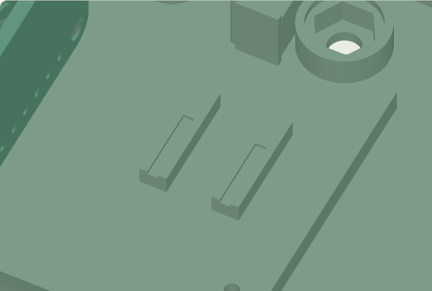
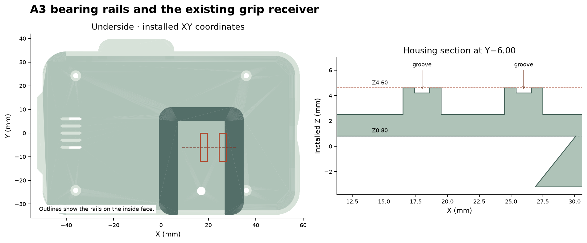

# R0014 housing with built-in A3 board supports

**Power-key fit correction.** Install the cap from inside with the switch board and keeper removed. The legacy switch rim catches the wall during a straight drop. Use R0015 plate 1 for the complete key assembly trial. [Revised procedure and applicable prints](../TW-A-0001-R0015/README.md)

**Use plate 1 of the R0014 X1C project for the new housing.** If plate 7 from the R0013 project is already printing, finish that job. Keep all eight PCB gauges and the six small square A4/A5 spacers. Set aside the two long A3 strips when using this housing. The R0014 plate 7 omits those two strips. [Editable X1C project](Printing/Thai-Waters-R0014-PCB-Fit-X1C.3mf) · [Plate 7 map](Printing/plate-7.png) · [Interactive PCB assembly](../../../docs/models/R0014-PCB-assembly.html)

TW-A-0001-R0014 pairs housing **TW-P-0001-R0011** with electrical integration **TW-A-0002-R0006**. In the installed R0013 assembly, both strips belonged to the single member `adhH`. They represented die-cut 3M 4991 VHB foam, 2.3 mm before compression and 2.10 mm installed. The loose plate-7 strips represented that installed height for dry fit. R0014 replaces both foam footprints with PETG rails fused into the housing. [Original foam definition](../../electronics/haptic-r0009/place.py) · [Housing STEP in installed coordinates](CAD/housing-battery-bay.step) · [Receiver-down STL](Print/housing-battery-bay.stl) · [Pose and mesh digest](part-orientations.json)



## Seat the A3 gauge

1. Set the empty housing display-side up with the reel to the right and the USB opening to the left. The two short raised rails run toward the service edge. Clean any strings or debris from both shoulders and from the groove in each rail.
2. Place the A3 gauge directly across the rails. Its flat back faces the floor and its tall J1 header faces the bottom/service edge. The rail centers sit 7.20 and 15.20 mm to the right and 10.80 mm above the board’s lower-left corner in installed plan view. The board measures 20 × 20 mm. Align its right edge 16.20 mm inboard of the X47 reel-wall plane. Keep the housing level while handling this loose dry stack.
3. Check both sides for rocking and measure the floor-to-bearing rise near each end. Target **2.10 mm** from the inside floor at Z2.50 to the board underside at Z4.60. Adding a long strip or any tape across a bearing face raises the board. Keep each groove empty for the inert trial. Fit the remaining boards and battery gauges using the [assembly guide](../../../docs/models/R0014-PCB-assembly.html).
4. Record the measured rises, rail flatness, header and wire clearance, and case closure with each pack gauge. The real header has five pin tails extending 0.4675 mm below the board. The solid printed header omits these tails and the detachable plug. Support the board separately before operating the real plug during a de-energized trial.

## Retention trial for a populated board

The rails support downward load. The unbonded board can lift or slide. Each rail has a 1.20 mm wide × 8.00 mm long × 0.40 mm deep channel open toward +Y. It provides a controlled space for trialing an electrically insulating adhesive. Each channel holds 3.84 mm³ up to the bearing plane and faces 9.60 mm² of the modeled PCB underside. The two 0.90 mm shoulders and the 4 mm full-width end set board height mechanically.

Evaluate the adhesive first on the actual printed PETG and a representative PCB finish. For a de-energized retention trial, record the adhesive, measured dose and cure conditions. Dispense into the open grooves before lowering the board, keep the shoulders clean, and support the board on both rails during cure. Inspect for trapped material under either land, squeeze-out at each mouth, adhesive entering holes, and contact with leads or solder. Verify seating height after cure. Set the working dose by measuring wetting, seating height and squeeze-out on trial samples. Adhesive selection, bond strength and powered release remain open. Test board pull, shear, vibration, haptic operation and repeated connector handling before relying on this joint.

## Geometry and fit evidence

| Check | Reopened CAD result |
|---|---|
| Rail centers and size | (18, −6) and (26, −6) mm. Each spans 3 × 12 mm and rises 2.10 mm. Each 36 mm² root meets the full inside floor. |
| Real PCB bearing area | West 26.25863 mm² and east 26.11726 mm² of 26.40 mm² nominal hard lands. Board holes account for the difference. Both board-to-land gaps and intersections are zero. |
| Header and nearest fixed lead | Minimum of 2.36394 mm to the five installed CviLux header pins. Closest adjacent fixed motor lead is 1.025 mm from the west rail. |
| Moving plug and flexible W4 leads | Through the full 13° rocker press and 8.25 mm withdrawal, the rigid group stays at least 3.25989 mm above the rails. The smallest continuous wire-to-rail bound is 4.26448 mm on SDA at travel 0–0.03125 mm. |
| Pack variants | The nearest added rail is 8.40 mm from the installed Adafruit envelope and 9.25 mm from the alternative maximum PKCELL body. |
| Export and negative control | 154 installed members. All 153 carry-forward members retain their original placement. No new positive-volume interference. Lowering the board intentionally by 0.25 mm produces 6.56466 and 6.52931 mm³ of interference. |

The two rails add 143.52 mm³ of housing material. Their combined solid fits inside the old foam volume, including when adhesive is confined to both channels. A global difference against the baseline shows zero removed housing material and zero added material outside those interior rails at the test tolerance. Both reviewed footprints retain 1.70 mm of continuous floor stock above the Z0.80 exterior face. The east witness includes the edge of the existing grip receiver lip at X26.90. [Exterior witnesses and CAD checks](QA/housing-geometry.json) · [Whole-assembly fit and individual pins](QA/installed-fit.json) · [Continuous rail clearance](QA/rail-service-motion.json) · [Export and round-trip check](export-verification.json) · [Installed member ledger](installed-step.json)



[Native slicing results](Printing/QA/native-all.json) · [Independent plate 1 reopen](Printing/QA/native-reopen.json) · [Rail toolpath close-up](Printing/QA/rail-toolpaths.png). Physical print completion, actual bearing height, adhesive compatibility, retention, solder fillets and production acceptance require physical measurements.

## Rebuild and review

Use the project’s CadQuery, OpenCascade, manifold3d, trimesh, NumPy, SciPy, FCL and Matplotlib environment. From this directory, run the housing build, supply the verified local R0013 dressed STEP to the assembly builder, then check the reimported R0014 STEP. A fresh STEP export can have a different timestamp and digest. The scripts measure the geometry, register current artifact digests and fail on a mismatched R0013 source digest.

```text
python build_housing.py
python assemble.py /local/r0013-assembly/roundtrip.step /local/r0014-assembly
python check_fit.py /local/r0014-assembly/roundtrip.step
python check_motion.py
python render_section.py
```

The housing STEP, BRep, STL and engineering reports are available here. The full dressed assembly uses supplier CAD and is generated in the local engineering checkout. The local builder writes TW-A-0001-R0014-dressed.step and its gzip archive. The R0013 connector limitations and physical test holds continue to apply. [CAD distribution record](../../../third-party/NOTICE.md) · [Seated supplier-geometry review](../../../quality/seated-connector-review.md)
