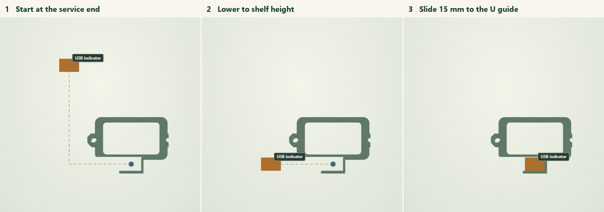

# R0016 USB indicator entry

Use this housing for the **leadless USB1 gauge** on Plate 7. Use the supplied Bambu Studio project settings. Its verified slice leaves 0.10 mm of vertical clearance for the nominal gauge; actual bead height and bridge sag still matter. A channel under the USB-C well opens toward the service-cover end of the case. The LED still points at the U light guide. Lowering the card directly over its final position hits the roof of the USB-C well. [R0016 3D guide](../../../docs/models/R0016-PCB-assembly.html) · [Bambu Studio project](Printing/Thai-Waters-R0016-PCB-Fit-X1C.3mf)

## On the workbench

1. Start with the empty, unpowered open housing. Keep the display, battery, battery bridge and service cover out. Set the case display-side up, with the USB opening on your left and the service edge nearest you. Clear any loose strings and inspect the side entrance under good light.
2. Pick up the little USB1 gauge by the board edges. The raised LED faces left toward the USB wall, its 4.80 mm board edge points front to back, and its flat back faces the open bay. Keep the card upright throughout.
3. Lower the card **15 mm toward you from the U light guide**, just beyond the service-side end of the USB-C well. At shelf height, slide the card **15 mm away from you**, parallel to the left wall, until it reaches the far stop. The wider view and the cutaway in the guide show the same movement. Use light pressure on the edge of the gauge. Stop if it catches.
4. Inspect the lower edge on the shelf, the flat back behind the low inner lip and the LED aligned with the end of the U guide. Withdraw toward the service edge before lifting out. Record whether the gauge seats, withdraws freely and stays located when the housing is handled. The far stop locates the card in one direction. If the printed passage pinches the gauge, inspect under the roof for a loose strand or a sagging bridge and record the obstruction before proceeding. Reverse retention, wire strain relief and vibration still need a physical trial.

If you have an **R0013, R0014 or R0015 housing**, skip the USB1 installation and set the gauge aside while you check the other parts. For the revised dry fit, reuse the existing PCB gauges and print only the R0016 housing on Plate 1. [R0013 flat-floor guide](../../../docs/models/R0013-PCB-assembly-corrected.html) · [R0014 guide](../../../docs/models/R0014-PCB-assembly.html) · [R0015 guide](../../../docs/models/R0015-PCB-assembly.html)

## What the models verify

| Check | Result |
|---|---|
| Former straight drop on R0013–R0015 | First housing contact from above occurs 13.01 mm before the seat. At 11 mm above the seat the populated board overlaps the housing by 3.865 mm³. |
| R0016, lowering at the service-side entrance | Both board and LED clear the housing throughout the vertical motion. The gauge begins above the rim and has at least 1.875 mm clearance to the housing during this leg. |
| Side entry and seat | Continuous rigid CAD sweep has zero overlap. The shelf and far stop intentionally touch the seated PCB. The LED remains approximately 0.298 mm from the U guide. |
| USB socket and other components | Local cuts and additions are recorded in installed coordinates. A 0.60 mm roof separates the central slot from the USB well. The housing comparison and installed STEP report record the changed material and its intersection checks. |
| Electrical build | The real lamp is soldered to the display assembly. With the lamp held seated, the existing W4B and W4C leads cannot span the full 18 mm vertical display motion in the dry guide. Wired assembly, retention, optical output and service remain open. |

[Gauge and actual emitter sweeps](../TW-A-0001-R0015/QA/usb-indicator/R0016.json) · [Rigid-body retention of the earlier boards](../TW-A-0001-R0015/QA/usb-indicator/legacy-trap.json) · [R0013 obstruction](../TW-A-0001-R0015/QA/usb-indicator/R0013.json) · [Lead geometry and length check](../TW-A-0001-R0015/QA/usb-indicator/wiring.json) · [Native slice and print preparation](Printing/README.md)

The five existing USB-lamp ngspice cases were replayed with the unchanged circuit. All five reproduced the registered measurements, including 0.812 mA at nominal input. Physical brightness and supply behavior still need a powered sample. [Circuit cases and limits](../../electronics/usb-status-r0003/simulate.py) · [Registered readings](../../electronics/usb-status-r0003/simulation/results.csv)

Housing **TW-P-0001-R0013** retains the R0015 switch relief and R0014 haptic-board rails. The paired electrical configuration is **TW-A-0002-R0006**. Record the as-printed fit, reverse retention and wired assembly trial in [hardware issue #99](https://github.com/natthapolvanasrivilai/thai-waters-handheld/issues/99). [Housing STEP](CAD/housing-battery-bay.step) · [Print STL](Print/housing-battery-bay.stl) · [Housing comparison](QA/housing-geometry.json) · [Installed assembly verification](export-verification.json) · [Power cap route](QA/power-key/cap-path.json) · [Key board and keeper](QA/power-key/key-path.json)

To reproduce the geometry, run the [housing builder](build_indicator_housing.py), then the [installed assembly check](assemble.py) with the registered R0015 dressed STEP and a local output directory. Run the [USB indicator motion check](../TW-A-0001-R0015/QA/usb-indicator/check_motion.py) for the original and revised housings. The complete dressed supplier assembly stays in local storage.
