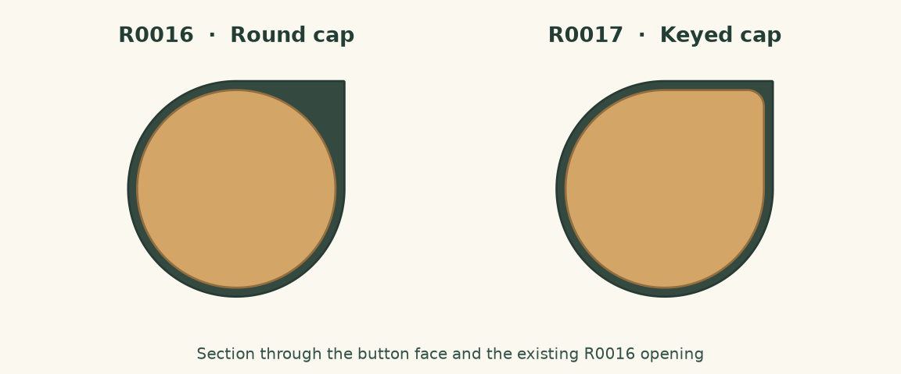

# R0017 keyed power cap

Use this cap with the R0016 housing (TW-P-0001-R0013). Its pressing face and retaining flange follow the three curved quadrants and the single square corner already present in the opening. A small radius on the corner leaves room for the printed internal radius. The original power symbol and the switch centre are preserved.

## Print and fit

1. Print the [cap-only Bambu Studio plate](Print/R0017-keyed-power-cap-X1C.3mf). It contains one opaque PETG part, flange on the bed, on the X1C with a 0.4 mm nozzle. The native estimate including setup is about nine minutes. Use the existing housing, retainer and board gauges.
2. With power disconnected and the housing open, set the switch board and keeper aside. Match the keyed corner to the corner in the hole. Lower the cap from the open display side and slide it 2.50 mm outward. The broad flange stays inside. The [3D guide](../../../docs/models/R0017-PCB-assembly.html) opens this step at the alignment point. Move the slider fully right to see the original approach.
3. Hold the cap seated while lowering the board and keeper. Inspect the reveal around the face. The solid Plate 7 switch gauge is for alignment. With a real switch, press at the centre, then near each edge. The cap should return on every release and the symbol should stay upright. Stop if the face rubs, sticks down, or rolls past the keyed corner. Record the press feel and angular play with the actual printed pair.

## Verification

| Check | Result |
|---|---|
| Nominal reveal | 0.25 mm between the pressing face and matching straight/curved aperture sides. The flange has 0.30 mm side clearance. |
| Insertion and travel | The full 24 mm drop, 2.50 mm outward slide and 0.50 mm inward press clear the nominal housing. The outward shoulder gap at the seat is 0.01 mm. |
| Rotation | With the cap centred, the stop engages at approximately 5.4° in either direction, both seated and fully pressed. The earlier cap clears a 90° turn. Printed play and off-axis finger loads require a sample. |
| Switch | The first 0.05 mm takes up the nominal actuator gap. Four shallow pockets clear the fixed switch-cover rivets through the next 0.45 mm. The minimum fixed-cover clearance at full travel is 0.19 mm. The original PCB and keeper fit after seating the cap. |
| Print | Two independent native slices showed deposition in the keyed corner on all ten layers, clear first-layer reliefs at all four rivets and zero support. The cap plate omits the other device parts. |
| Assembly | Reopened the full 154-member dressed STEP. The 153 other installed components retain their parent placements. The electrical configuration remains TW-A-0002-R0006. |

[Fit and rotation checks](QA/fit.json) · [Native slice results](QA/native-print.json) · [Installed STEP verification](export-verification.json) · [Cap STEP](CAD/power-cap.step) · [Print STL](Print/power-cap.stl) · [R0016 housing and USB fit](../TW-A-0001-R0016/README.md)
