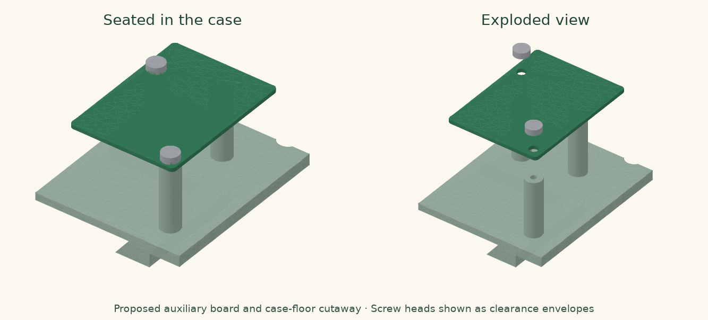

# Mount the auxiliary electronics to the case

[The populated design and the two-plate print project supersede this blank-board study.](../../electronics/case-board-r0001/README.md)

The original proposal was to keep the purchased Waveshare screen/controller on its own original mounts. Combine the A4 controls/audio interface and A5 USB-input circuit on one custom PCB. Seat this board on features printed into the rear housing, then fasten it before fitting the display. A short, disconnectable harness is the intended electrical connection. This eliminates six individual spacers and twelve adhesive interfaces at the display. The reel sensor and haptic parts still have their own functional locations.

This is a packaging study based on R0017. The released R0016/R0017 print and fit guides describe the earlier prototype. The integrated seats on the plastic display gauge reproduce that earlier geometry. They are unnecessary for testing this new mounting idea. Leave the real display unmodified.

## Measured first layout

The [cutaway STEP](case-mount-concept.step) shows the actual segment of the R0017 case floor carrying two integral screw posts and a third integral bearing. The housing supports the full board. The screw heads are clearance envelopes. The green part is a **bare board blank**, 24.5 × 33 × 0.8 mm. The screen still occupies the space above the auxiliary board. Its PCB carries no auxiliary-board mounting load.

| Nominal CAD check | Result |
|---|---|
| Extend the original six pad footprints down to the floor | Five positions strike other components or wires. One would pass through the A3 plug and header. |
| Install the board blank and supports in the new positions | The posts reach the case floor. Closest seated harness spacing found at a post is 0.328 mm. One proposed screw head intersects the old A5 ground lead. The old W2, W3 and W7 terminations also run through the new blank. |
| Lift the rigid display assembly straight up 18 mm | Conservative full-stroke envelopes clear the modeled display components. Minimum nominal clearance to a screw-head envelope is 0.40 mm. The blank itself clears by 0.50 mm. |
| Manufacture and service | Component layout, insulation, connector selection, wire exits, wire slack through display removal, driver access, boss strength and safe motion of the CviLux harness still require design and testing. |

[Reproducible CAD check](check.py) · [Part-by-part results](fit.json) · [Existing circuits on A4](../../electronics/pcb-r0004/README.md) · [A5 USB behavior and open power tests](../../electronics/usb-entry-r0006/README.md) · [Hardware tracking #100](https://github.com/natthapolvanasrivilai/thai-waters-handheld/issues/100)

No new fabrication or print release is authorized by the blank-board study. The two former PCB footprints sum to 667 mm², but area alone cannot establish routing, antenna clearance, heat dissipation, or component height. Keep the existing USB source-detection and current-limit checks when merging the circuits. Exercise the highest pack envelope, connector stroke, tool access and the real harness with the populated PCB before freezing the housing.
