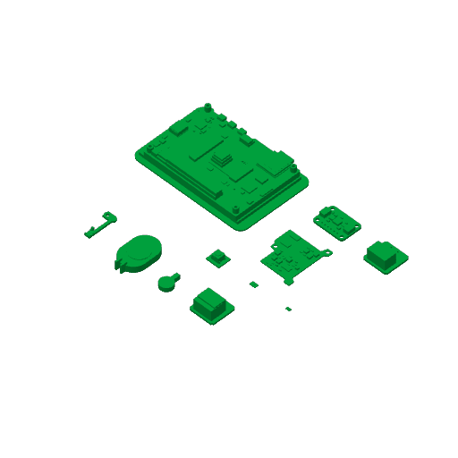

# Thai Waters enclosure fit test · TW-A-0003-R0003

**Use this revision for the next unpowered enclosure test.** It pairs the Waveshare ESP32-S3-Touch-LCD-3.5B V2 outline with the case-mounted combined control/USB board R0001 and the A3-CIE R0002 haptic layout. Both custom boards are routed. Power architecture, controller termination locations and first-article hardware still have open acceptance criteria. The assembly register identifies this as a fit kit.

[Download the editable X1 Carbon project](https://github.com/natthapolvanasrivilai/thai-waters-handheld/releases/download/enclosure-fit-r0003-1/Thai-Waters-R0003-Enclosure-X1C.3mf) · [Download the eight-stage offline 3D assembly guide](https://github.com/natthapolvanasrivilai/thai-waters-handheld/releases/download/enclosure-fit-r0003-1/Enclosure-fit-guide.html) · [Print and inspection sheet for all 30 objects](first-article.csv) · [Current hardware gate](../../../quality/hardware-gate.md)

## Which plates to print

Start with **1, 2 and 7** for the new housing, bezel, crank and full-height component checks. Use plates 3–6 from this project whenever you need the grip, light guides, flexible pieces or battery gauges for complete closure. An earlier bare-board gauge can miss package interference. The earlier display gauge with bonded spacer seats belongs to the retired board arrangement.

| Plate | Contents | Saved X1C surface and filament |
|---|---|---|
| 1 | Rear housing, integral board supports, four bezel bosses and relieved rear controller-screw opening | Supertack, opaque PETG |
| 2 | Bezel, rotor with crank pocket up, stem, grip, collar, keyed cap, keepers, switch retainer and battery bridge | Supertack, opaque PETG |
| 3 | Removable rod handle | Supertack, opaque PETG |
| 4 | Charge, USB and power light guides | Supertack, clear PETG |
| 5 | USB mask and service cover | Textured PEI, external-feed TPU |
| 6 | Two alternative pack gauges, including the maximum drawing envelope | Supertack, PETG |
| 7 | A1 display/controller, A2 sensor, A3 bare and plug-seated alternatives, populated combined board, power switch, two USB indicator boards, speaker and motor gauges. The removable USB lamp shelf is a **device part**. | Engineering Plate, PETG |

The modeled component height on the combined PCB is 2.385 mm including the substrate and copper. The printed gauge spans 2.400 mm and encloses all 30 modeled package solids. Both mounting holes and the board outline remain available for fit checks. The speaker gauge spans 19.90 × 32.50 × 7.00 mm including the gasket and lead exits. The motor gauge spans 10 × 15 × 3.55 mm. The alternate A3 includes the occupied space of the seated plug up to installed Z15.41 mm. Substitute it for the bare A3. Use a wired connector for retention and unplugging. [CAD comparisons](gauge-datums.json)

## Assemble and inspect

1. Open the 3MF as a **project**, keeping the orientations and plate settings. Confirm the nozzle is 0.4 mm and the selected plate matches the one on the printer. Cool the parts fully. Lift by the broad base. Inspect the new housing bosses and both ends of the crank pocket under side light. Record any whitening or peeled layers on the inspection sheet.
2. Prepare **five additional Accu SHP-M2-6-V2-A2, M2 × 6 mm T6 pan-head screws**, one for the removable lamp shelf and four for the bezel. Use the existing two M2 × 4 screws for the combined board. The new Ø1.64 mm pilot holes are designed for an M2 × 0.4 hand tap. Prepare the empty housing and clear chips before installing any gauges. If a screw binds, inspect the pilot rather than tightening through the resistance. [Fastener specification](../../components/standard-fasteners/README.md) · [Combined PCB BOM](../../electronics/case-board-r0001/bom.csv)
3. With the open housing on the bench, fit the speaker and motor gauges. Start the lamp shelf 14 mm toward the center and 24 mm above its seat. Lower vertically, then slide left against the USB wall. Seat it on both pillars and fit the shelf screw. The shelf has 1.00 mm screw-tip relief and 4.40 mm nominal engagement. Install the lamp separately. Lower the upright lamp 18 mm toward the service end from the U guide, then slide it back parallel to the USB wall. The LED faces the guide. The 18 mm route clears the board, emitter and the modeled roots of both solder leads. Starting at 15 mm or 21 mm produces a collision with a conservative wire envelope. Carrying the lamp on the shelf during its sideways movement hits the USB well. Leave the far ends free for dressing. Check that neither speaker lead is trapped under the arm.
4. Fit A2 on the reel wall and A3 on the integral floor rails. Install the combined PCB package side toward the floor, with the screw heads toward the screen. It sits on two screw bosses and a third rest. Check for rocking. Insert the power cap from inside before the KEY board and retainer. Align its square corner with the aperture. Inspect the light guides and USB insert.
5. Try each battery gauge separately, with the intended dummy lead diameter and length, then fit the bridge. Lower A1 screen side up. Check that it seats at all four mounts without pressing a plug or package. Try the intended controller screws and driver with the rod handle attached. With a real CviLux sample, check that the latch releases and the plug clears with the display seated and the main loom fixed. Keep the cell disconnected.
6. Seat the bezel **by hand first**. It should lie flat before any screw is tightened. Start the four M2 × 6 screws and snug them evenly. The heads sit 0.10 mm below the nominal face. Check the screen gauge for a witness mark and remove and refit the bezel to inspect the pilot walls. Trial folded and deployed crank rotation, rod grip retention, service cover and USB-C cable access. Record each result on the sheet.

## Review of the hardware

| Assembly or function | Evidence on this configuration | Outstanding evidence before production |
|---|---|---|
| Shell, bezel and controller screws | Changed from a friction-only bezel to four serviceable screw locations. Through the final 12 mm of closure the new pads clear the modeled parts. Nominal installed glass-to-pad clearance is 0.32 mm. All four Ø4.04 mm access cylinders clear shell and attached grip. The local boss lands reach 37.20 mm from the centerline. Overall printed shell width on this axis grows from 74.25 to 76.90 mm. | Actual head tolerance, corner seating, bezel rocking, torque, repeat removal and case comfort. [Closure checks](closure-check.json) |
| Lamp, USB opening, light guides and speaker | Removed the support-founded lamp shelf from the shell. The separate shelf has 75.13 mm² of bed contact and prints without support. Its continuous drop and slide clear the housing and seated speaker gauge. Nominal speaker clearance is 0.65 mm and the W30 jacket is 0.44 mm away. | Confirm soldered lead dress and strain relief, indicator visibility, light bleed, acoustic seal and plug access. [Shelf sweep](service-check.json) · [Lamp installation study](lamp-fit.json) |
| Reel, right-angle sensor, folding and detachable handles | Reinforced crank rim has 1.85 mm nominal stock and 1.50 mm at the front bevel. Its new print orientation faces the recess upward. Sensor registration, folded and extended clearance and the rod receiver have physical inspection steps. | Support removal, hinge strength, a captive deployed lock that resists reverse load, repeated wear, sensor gap/direction, mechanical clicks and handle comfort. An active force brake is a separate hardware requirement. [Reel CAD and motion](../reel-dfm-r0001/README.md) |
| A1 controller, touch, IMU, audio, radio and clock | Supplier V2 component envelope in a separate A1 gauge. The controller mounts and access use the supplier datums. Schematic and supplier mechanical documents are the available design inputs. | Check a real V2 board, locate the three USB/CC terminations, measure rework clearance and test external ports, IMU, RF, clock backup, touch and boot behavior. Qualify RF and electrical performance in the populated enclosure. [Controller integration](../../electronics/case-board-r0001/README.md) |
| A3 haptics, combined PCB and service harness | Fresh ERC, DRC, unrouted and schematic-parity counts are zero for both custom layouts. Continuous CviLux checks against the combined board, revised wires and new mounting parts give ≥0.508 mm rigid and ≥0.869 mm flexible-jacket clearance over 8.25 mm extraction. The rigid display lift with leads disconnected has ≥0.300 mm clearance to the checked mounts. | Qualify real contacts and crimp tool, wire bend radius, soldered taps, strain relief, withdrawal force, harness removal sequence and motor behavior. [Motion results](service-motion.json) · [Current electrical replay](electrical.json) |
| Battery, power key, charging and USB current limit | Maximum-pack gauge clears the changed hardware by 1.20 mm at the closest mount. The 73 current-layout USB cases produced 205 measurements. Two 330 mA starts without a cell deliver approximately 0 and 0.632 V to the PMIC, below its 3.9 V acceptance floor. Seven other failures were deliberate controls. | Resolve the USB startup/power-path requirement with a compliant input design. Qualify dead-pack recovery, load steps, charger heat, rail margin, physical battery and cable dimensions. Keep the prototype unpowered for this test. [Power design and measurements](../../electronics/case-board-r0001/README.md#circuit-and-harness) |
| RTC backup and optional reel brake | The RTC header is on the display assembly. The rechargeable backup pack still has no qualified part number, connector polarity, charge validation or matched CAD envelope. This kit has no dedicated backup-cell gauge or active reel-brake actuator. | Both can change the case or mounting layout. Confirm the backup charging circuit and cell/lead envelope before reserving or printing a production pocket. Qualify a brake and fail-released behavior before allocating its volume. [Clock hardware gate](../../../docs/wiki/Clock-and-saves.md) |
| Remaining electronics | Replayed the archived qualification suite with 60 historical, 85 candidate/control and 38 post-layout cases. The 38-case subset reproduced 75 within-limit measurements, 15 characterizations and two deliberate fault detections. Archived A4/A5 copper and earlier USB topologies belong to their named revisions. | Bench measurements on the current populated system for speaker load and thermal rise, power key, rail/bus timing, motor current, charge and emissions. Prototype packaging, drop, ESD, EMC, RF and battery transport evidence remain open. [Replay fingerprints](legacy-circuit-replay.json) · [Compliance record](../../../docs/wiki/Validation-and-compliance.md) |

## Print evidence and limits

All 30 instances produced model paths from bottom to top. The deposited-layer check found zero completely unbacked model components. Independent Bambu Studio sessions reproduced the changed plates 1, 2 and 7. The housing uses approximately 10.16 cm³ of support and the rotor uses 0.88 cm³. The small hinge stem still relies on a brim and the flexible mask has three model layers. The wall survey samples opposing faces. Chamfers, lettering and pin tips generate small individual readings. Layer overlap, even when continuous, cannot establish bond strength or safe support-removal force. The R20 carrier-to-floor coupon is the only earlier physical fit confirmation applicable here. The real A2 board and populated electronics still need a first article.

[Per-part measurements and hand checks](first-article.csv) · [Native deposition](deposition.json) · [Bed contact, supports and backing](part-paths.json) · [Wall and underside survey](thickness.json) · [Independent reslices](reopen.json) · [Housing STEP](housing.step) · [Bezel STEP](bezel.step)

To reproduce, extract the registered solids using the [case-board workflow](../../electronics/case-board-r0001/README.md). Run `project.py CACHE`, `closure_check.py CACHE`, `service.py CACHE`, `lamp_fit.py CACHE`, `service_motion.py CACHE` and `viewer_build.py CACHE`. Slice all plates to an `all` directory and independently reopen plates 1, 2 and 7 to sibling directories `reopen1`, `reopen2` and `reopen7`. Keep Bambu's report, sliced archive and G-code in each. Run `verify_print.py PARENT` and `audit_table.py`. Run `electrical.py KICAD_CLI NGSPICE` for the current electronics. The archived system replay uses the R0013 routed replay inputs and the original R0012 USB control copper.
