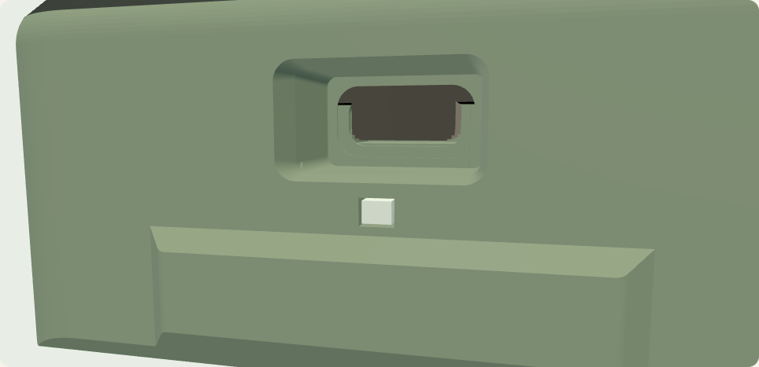
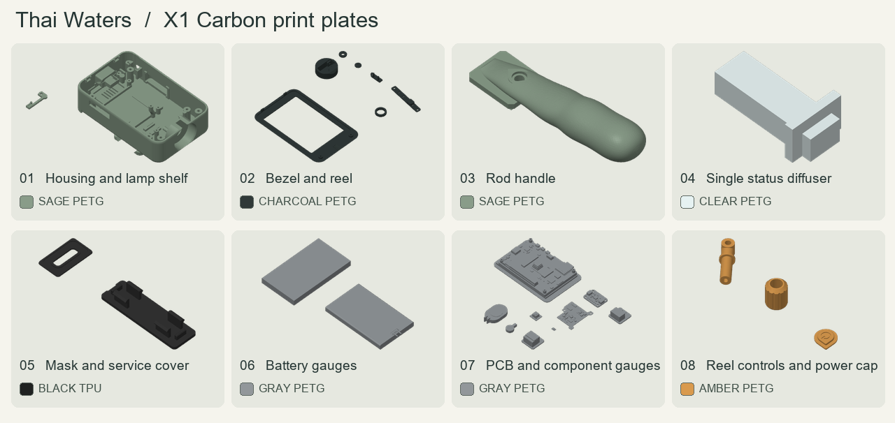

# R0004 enclosure fit and single status light

Use [the eight-plate X1 Carbon project](Thai-Waters-R0004-X1C-Color-Fit.3mf) for the next **unpowered** enclosure trial. Open [the offline assembly guide](Enclosure-fit-guide.html) and choose **Inspect status light** for the USB-wall close-up. The R20 fit project established the single-diffuser and clean-front design. R0004 restores both on the housing that accepts the newer case-mounted PCB.

## Fit sequence

1. Print plates 1, 2, 4 and 7 to check the status light, display and closure together. Plate 4 contains one clear diffuser. Remove any brim from the lens shoulders before insertion.
2. With the empty shell open, lower the diffuser 22 mm inboard of its seat. Slide the narrow end toward USB until the flange stops. Fit the speaker gauge. Lower the shelf inboard, slide it toward USB and secure it with one M2 × 6 screw. Its low, continuous retaining lip captures the diffuser below the emitter path. Check that the lens stays captive under light finger pressure.
3. Slide the gray RGB carrier gauge into the mounted shelf from the service end, emitter facing the diffuser. Check that the shelf and gauge sit square and that the outside shows one window below the USB socket. The nominal emitter-to-lens gap is 0.25 mm.
4. Install the remaining electrical gauges as shown. Hold the charcoal bezel level with its hooks on the USB side. Start slightly toward the reel, lower almost to the rim, slide toward USB, then seat flat. Use two M2 × 6 screws from the rear. Check that the front stays smooth, the glass stays unloaded and the screws release for service.
5. Record the results on the [first-article sheet](first-article.csv). Keep the board and battery gauges unpowered. Perform the wired and powered checks later on a populated assembly.

## Printing

| Plate | Contents | Filament |
|---|---|---|
| 1 | Housing and status shelf | Sage PETG |
| 2 | Bezel, rotor and internal retainers | Charcoal PETG |
| 3 | Detachable rod handle on its broad side | Sage PETG |
| 4 | One status diffuser | Clear PETG |
| 5 | USB mask and service cover | Black TPU, external spool |
| 6 | Two interchangeable battery gauges on broad faces | Gray PETG |
| 7 | PCB, emitter, speaker, motor and seated plug gauges | Gray PETG |
| 8 | Crank, knob and keyed power cap | Amber PETG |

The X1C project uses a 0.4 mm nozzle and one filament per plate. PETG plates specify the Engineering Plate and TPU specifies Textured PEI. Match the physical plate and spool when loading each job. The rod handle now stands 34.55 mm high and deposits 834.9 mm² on the first layer. Native G-code shows one 1.65 mm² ledge beginning on slicer support. Support paths cover 57% of its projected area at the configured separation. Check the surface after support removal. [Per-part slice evidence](verified-plates.json) · [Handle support measurement](handle-support.json)

## Optical and electrical interface

The enclosure has one 2.50 × 2.00 mm window, one captive clear PETG diffuser and space for one common-anode RGB emitter. The assembly guide uses Kingbright's APTF1616 supplier model. The printable carrier gauge represents occupied space, including the 1.6 × 1.6 × 0.7 mm emitter. Proposed indication, in priority order, is amber while charging, green while running, blue when USB is present and the unit is idle, and dark when off and unplugged. Charging indication must work with the game processor off. A dark diffuser in the viewer represents the unpowered assembly. [Supplier part](https://www.kingbrightusa.com/product.asp?catalog_name=LED&product_id=APTF1616SEEZGQBDC) · [Supplier STEP](https://www.kingbrightusa.com/images/catalog/3D/STEP/APTF1616.STEP)

**Electrical work remains open.** The older USB-only LED/resistor circuit cannot drive these states. The four-terminal carrier, three current-limited channels, off-state charge detection, isolation against backfeed and harness still require electrical release and bench verification. Do not populate the older lamp as the RGB circuit. The two previously simulated batteryless startup failures remain open. [Current configuration BOM changes](../../../sourcing/production-intent/Enclosure-R0004-delta.csv) · [Prior USB simulation results](../enclosure-fit-r0003/electrical.json)

## Geometry and evidence

Each of three transverse sections through the USB face contains one aperture. The exported native bezel has a continuous front skin around the display opening. The two blind pilots leave 1.00 mm of face material. The nominal glass clearance is 0.25 mm. The assembly motion was sampled with the display seated and both screws removed. The level bezel starts 0.35 mm toward the reel, stops 0.12 mm above the seat, slides toward USB and seats. The final seat is a designed contact. Print tolerances, hook retention, driver feel and illumination require a first article. [Diffuser, shelf and emitter insertion checks](light-motion.json) · [Fit measurements](fit.json) · [Sampled installation](closure-motion.json) · [Housing STEP](housing.step) · [Bezel STEP](bezel.step) · [Diffuser STEP](diffuser.step) · [Shelf STEP](shelf.step)

The scripts use the registered R0017 part BReps, the archived R0003 native project and the Kingbright STEP for the viewer. Build the installed parts with `interfaces.py CACHE`, then the project with `color_project.py CACHE`. Check the CAD with `fit.py CACHE` and `closure_motion.py CACHE` and `light_motion.py CACHE`, and the delivered meshes with `inspect_project.py`. Slice all plates in Bambu Studio, run `check.py SLICE_DIRECTORY` and `path_detail.py PLATE_3_GCODE`. Build the guide with `viewer_build.py CACHE SUPPLIER_STEP`.
