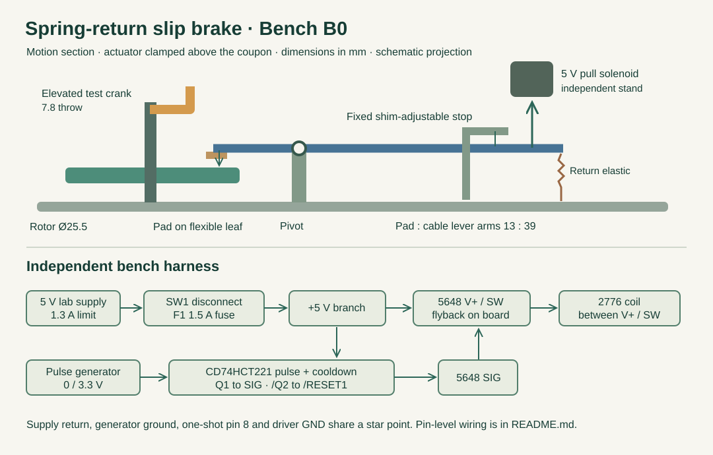

# Reel snag brake · B0 bench experiment

A snag can briefly load the crank while the player continues to turn it. This tabletop fixture presses a replaceable felt shoe against a smooth rotor. Its spring leaf and travel stop set the maximum normal force. Removing power lets a light return elastic pull the rocker off the rotor. The crank retains a slip path in either direction. The experiment is ready to print and instrument. Physical torque, wear, heating and release have yet to be measured.

## Relationship to the handheld

The Rev F product retains an AS5600 magnetic angle sensor (A2, Adafruit 6357, I²C 0x36) and the diametric 6 × 2.5 mm reel magnet. Its nominal magnet-face-to-sensor-body gap is 1.20 mm. Shaft-to-sensor clearance is 1.083 mm. The inherited side well has only 0.60 mm radial clearance around the rotor. The 6.50 mm grip-to-fold-and-turn envelope in Rev F measures a separation between moving/installed parts. No internal brake cavity has been reserved. The optional DRV2605L (0x5A) and ERM provide body rumble. Keep the coil, timer and its 5 V return on the independent bench harness. The product’s battery, power key, sensor bus and haptic harness have no assigned brake interface. [Reel geometry](../reel-detent/README.md) · [Magnet gap data](../../rev-E/results/clearances.json) · [Rev F grip sweep](../../rev-F/rod-grip-checks.json) · [Angle sensor breakout](https://www.adafruit.com/product/6357) · [Haptic driver](https://www.ti.com/product/DRV2605L)

| Method | Snag at standstill | Release and engineering tradeoff |
|---|---|---|
| Smooth axial shoe with return elastic | Can create a finite breakaway torque | Bench choice. Measure loaded and unloaded friction, return time and wear. |
| Existing body rumble and reel click | Tactile cue with free crank | Available product alternative for a snag. No actuator load on the spindle. |
| Hobby servo pressing a pad | Can press at standstill | Gear friction may hold its last position after power loss. Requires a separate release mechanism. [Example servo](https://www.adafruit.com/product/169) |
| Shorted motor or eddy-current brake | Torque approaches zero at zero speed | Suits further study for fast runs. Gearing, magnets and added rotating inertia affect the encoder and existing feel. |
| Toothed pawl | Can stop motion entirely | Positive engagement can shock the knob and transmit the user's full applied torque. The smooth rotor instead allows controlled slipping. |

## Print and assemble

1. Print the four [STLs](Print/) in their supplied orientations. Start with PETG, 0.20 mm layers, four walls and solid fill through the 1.2 mm spring leaf. Support the rocker locally under the pivot boss/leaf overhang and the bridge in the base. Clean surfaces and measure the leaf and stop. The leaf's length follows the XY print layers. The base is 92 × 42 mm, with four Ø4.2 mm mounting holes. Four mesh solids passed water-tightness checks, and nominal seated printed parts show zero intersecting volume. [Assembly STEP](brake-coupon.step) · [CAD source](build_coupon.py) · [Geometry checks](geometry.json)
2. Clamp the base to a flat board. Place the rotor on the raised journal seat, fit the crank over the D-flat and retain the hub with the M3 × 35 axle, washers and stop nut. Adjust for 0.15–0.30 mm end float and free rotation. Check freely rotating clearance at every angle. Keep washers off the pad track. Use a smooth shank at the running surface.
3. Bond the 2.5 × 3 mm felt patch under the tangential print leaf, centered 11.0 mm from the reel axis. Start with 0.75 mm bonded pad thickness and verify a 0.25 mm nominal free gap with the rotor lifted to its worst axial position. Adjust actual thickness as needed for a positive gap at all angles. Install the M3 × 20 side pivot in its two ears and lock its nut without pinching the rocker.
4. Thread a soft pull cord through the x=63 mm hole and the downward return elastic through the x=67 mm hole to the x=68 mm base anchor. Set minimum elastic tension that reliably seats the rocker on its rest stop in all orientations. Clamp the solenoid to a separate upright directly above the pull hole, with its energized stroke taking up cord. Its return spring and the rocker elastic must leave a measurable running gap when unpowered. Keep loose cord outside the crank sweep and shield it during powered tests.
5. Start with a rigid shim against the underside of the printed upper stop, limiting motion to light pad contact. With power disconnected, pull by the cord and measure torque at the stop before trying powered pulses. Remove shim thickness gradually until the target holds in both directions. Stop and refit a thicker shim if breakaway or running torque exceeds 10 mN·m. The cable, pad or rocker must never catch a rotor edge. Use external instruments before testing with fingers.

The pad, stop and cable centerlines lie 13, 34.5 and 39 mm from the pivot. Centerline stop rise of 2.10 mm predicts approximately 2.37 mm cable movement and 0.79 mm pad travel. The nominal free gap leaves up to 0.54 mm for leaf/pad deflection. First contact with the leading edge of the stop may occur earlier. Rotor end float, pad thickness, print tolerance and cord slack affect the actual result. [Nominal geometry](geometry.json)

For the 12 × 5 × 1.2 mm tangential leaf, assumed printed modulus of 1.5–2.0 GPa gives stiffness 1.88–2.50 N/mm using Ebt³/(4L³). The design-center full stroke predicts 1.02–1.35 N normal force. At 11 mm pad radius and assumed dry friction coefficient 0.25–0.55, incremental drag is about 2.8–8.2 mN·m before bearing drag. Felt compliance and print anisotropy can shift either end. The nominal 3 mm / 80 gram-force supplier datum gives about 0.785 N actuator force, ideally 2.35 N at the pad before return force and pivot losses. Measure pull force across the chosen stroke and verify margin. The supplier lists a 20 mm body, 12.6 g mass and a 4.5 Ω ±5% winding. [Solenoid specifications](https://www.adafruit.com/product/2776)

## Wire the independent pulse limiter

Use a current-limited 5 V bench supply capable of at least 1.5 A, limited initially to 1.3 A. Bring +5 V through the manual disconnect and 1.5 A fuse to the board V+, timer VCC and the local bulk capacitor. Use 22 AWG for the coil power loop. Connect coil leads only across the driver load terminals V+ and switched output. The board carries its own flyback diode. Keep the switched current loop short and return it separately to the supply star point. Connect the timing board and lab pulse generator ground to that star. Use the indicated polarity on the 470 µF bulk capacitor. [MOSFET breakout](https://www.adafruit.com/product/5648)

| TI CD74HCT221E, PDIP-16 | Connection |
|---|---|
| 16 VCC, 8 GND | +5 V and ground. Bypass at the IC with 100 nF. |
| 1 /A1, 9 /A2 | GND for rising-edge triggering on the B inputs. |
| 2 B1 | Bench pulse (0→3.3 V or 0→5 V) through series 2.2 nF and 1 kΩ to B1. Fit 10 kΩ B1 to ground. Fit lower BAT85 anode at GND, cathode B1, and upper BAT85 anode B1, cathode +5 V. |
| 13 Q1 | Driver SIG with 100 kΩ to ground. Monitor high pulse duration here. |
| 4 /Q1 → 10 B2 | Falling edge of Q1 produces a rising edge on B2 and starts the cooldown. |
| 12 /Q2 → 3 /RESET1 | Holds the first device in reset during cooldown. |
| 11 /RESET2 | +5 V. 5 Q2 is the cooldown test point. |
| 14 CEXT1, 15 REXT/CEXT1 | Place the 1 µF ±5% film capacitor across 14–15 and 150 kΩ ±1% from 15 to +5 V. |
| 6 CEXT2, 7 REXT/CEXT2 | Place 10 µF ±10% low-leakage film across 6–7 and 330 kΩ ±1% from 7 to +5 V. |

Input AC coupling returns B1 low within about 0.1 ms on a held-high command. This matters because the TI truth table permits triggering on release of reset with specific prior A/B states. The approximate 0.7 RC timing estimate gives 105 ms ON and 2.31 s subsequent inhibition, or 4.35% ON at the nominal repeat limit. Component tolerance, capacitance leakage and the IC's timing coefficient require scope verification. First check power-on behavior and rapid triggers with the solenoid disconnected. Scope Q1 and Q2 with a held-high request, recurring requests and cycling supply. Fit the coil only after observing an ON pulse at most 120 ms and at least 2.0 seconds OFF between pulses (≤5.7% duty). A stuck-low-side MOSFET can still energize continuously. A 1.5 A fuse does not protect against a sustained 1.1 A fault. Operate this fixture attended with its manual cut-off reachable. Future internal hardware would require an independent switched supply cut-off/thermal protection and fault analysis. [TI pinout and timing](https://www.ti.com/lit/ds/symlink/cd74hct221.pdf)

## Driver results

The standalone ngspice 33 circuit uses a lumped winding, 0.1 Ω feed, silicon diode and a low-side MOSFET approximation. Inductance is an assumed 3–30 mH range. The decks apply a 105 ms gate pulse and omit the timer, moving armature, back-EMF from motion, harness ringing and thermal rise. The average column assumes one such pulse per 2.4 s. The decay time begins when the pulse ends. [Input decks and replay script](driver_check.py) · [Measured simulation output](driver-results.json) · [Raw simulator logs](driver-traces.zip)

| Electrical case | Supply | Coil R / assumed L | Peak current | Peak drain V | Winding energy | Average winding | Time to 10% current |
|---|---:|---:|---:|---:|---:|---:|---:|
| Nominal | 5.00 V | 4.500 Ω / 10 mH | 1.070 A | 5.864 V | 0.529 J | 0.220 W | 3.33 ms |
| High supply, low R | 5.25 V | 4.275 Ω / 3 mH | 1.181 A | 6.123 V | 0.621 J | 0.259 W | 1.08 ms |
| Low supply, high L | 4.75 V | 4.725 Ω / 30 mH | 0.970 A | 5.605 V | 0.437 J | 0.182 W | 9.38 ms |

At 120 ms and shortest accepted cooling interval, a conservative continuous-on copper bound of (5.25²/4.275) × 0.120/2.120 gives 0.365 W average. Electrical current decay alone cannot establish mechanical release time. To reproduce, run `python driver_check.py --engine <path-to-ngspice>`. Regenerate mechanical files with `python build_coupon.py` in an environment containing CadQuery and trimesh.

## Acceptance on the bench

| Trial | Procedure and acceptance |
|---|---|
| Dry mechanical slip | With a tangential gauge at 12.75 mm radius, torque in mN·m equals force in N × 12.75. Account for tare. Target total OFF torque ≤1.5 mN·m, ON running 3–7 mN·m and peak breakaway/running ≤10 mN·m. The hard limit corresponds to 0.784 N at the gauge or 1.282 N at the 7.8 mm crank. Record both directions, ten samples per condition. |
| Slow lift and fast run | Apply repeatable torque/rotation externally at standstill breakaway, 1 and 3 rev/s. Use a torque transducer or calibrated dynamic force measurement at ≥1 kHz for the short event. Capture force, angle, coil current and Q1 together. The rotor must slip continuously and retain its commanded rotation direction. |
| Release and loss of power | Monitor torque through commanded off, supply interruption mid-pulse and disconnected pull cord. Require return to baseline +0.5 mN·m within 100 ms after command falls or supply cut, and absolute steady OFF ≤1.5 mN·m. Repeat horizontally and inverted. Verify no delay from a wedged shoe after a held dry pull against the stop. |
| Fault behavior | Exercise stuck-high and burst triggers with a dummy load. Validate timer bounds and absence of recurring pulses without a fresh request. Simulate a shorted switch only with a suitably rated dummy load and verify manual cut-off. Inspect cords and pivot for jams, prove positive pad clearance after recovery. |
| Heating and wear | Run 1000 events at the fastest measured allowed repetition. Log coil, driver, pad support and ambient temperatures, peak current, free drag and loaded drag every 100 events. Abort the attended screening run if any measured part exceeds 50 °C or rises more than 20 °C above ambient, or the fixture binds. These conservative project screening thresholds require a new analysis for an enclosed product. Repeat slip tests on the warmed coupon. |
| Encoder interference | Mount a representative AS5600 assembly and its diametric magnet at its normal 1.20 mm body gap on a separate nonmagnetic rig. Start the clamped coil ≥80 mm away, then test the intended relative positions against an optical angle reference at slow/fast and stopped positions. Compare 24 angles through 360° with coil disconnected, energized and during release in both directions. Record AS5600 MD/ML/MH and unwrap counts. Proposed acceptance: valid magnet indication, no spurious direction changes, coil-induced error ≤2° and zero lost revolutions over 100 turns. Steel screws in this standalone fixture also require an iron-free control run. [AS5600 specification](https://ams-osram.com/products/sensor-solutions/position-sensors/ams-as5600-position-sensor) |

Log fixture identifier, pad batch and thickness, stop shim, actual rest gap/end float, pulse timing, speed and direction, supply, winding resistance, temperature and instrument resolution with each run. A measured torque cap and release in every orientation precede handheld trials. Installing resistance in a future case would also require revised CAD of the folding crank, screw/cord restraints, sensor and cell clearances, low-battery power-fault tests and EMC rechecks.

## Bench cost

The 29-line BOM allocates **USD 24.67** for the complete one-off coupon, independent driver and timing harness. The coil and driver are vendor list prices. The balance consists of planning allowances and allocated shop stock. The stand, bench supply and instruments are assumed available. Labor, freight, tax, minimum-order multiples and enclosed-product changes are excluded. This experiment has no approved production BOM delta. [Detailed quantities, prices and sources](bench-bom.csv)
