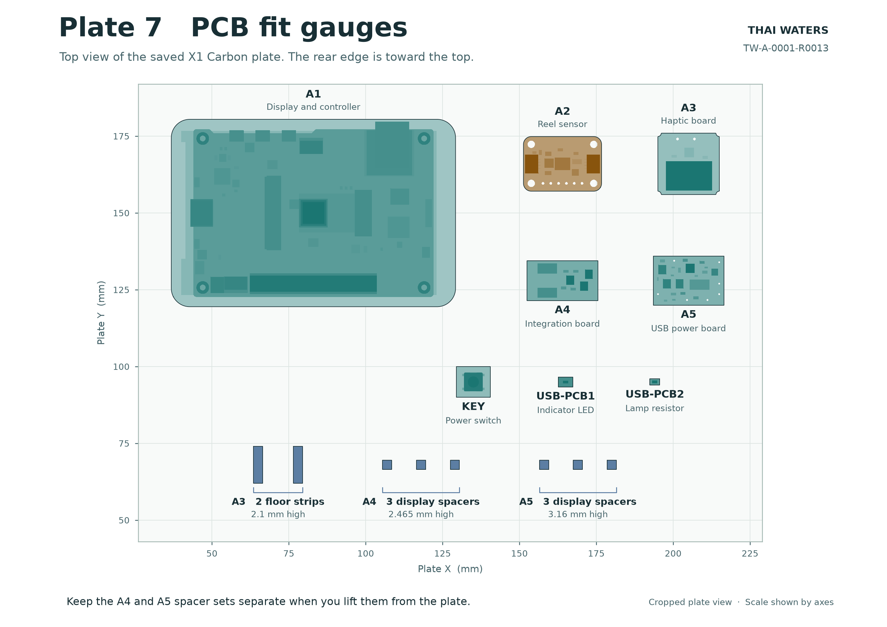

# Plate 7 · R0013 PCB fit kit

**Using an R0014 housing with these gauges?** Set the two long A3 strips aside and seat A3 directly on the built-in rails. All eight PCB gauges and the six square A4/A5 spacers transfer. The instructions below describe the earlier R0013 flat-floor housing. [R0014 fit sequence](../TW-A-0001-R0014/README.md)

[Open the X1 Carbon project](Thai-Waters-R0013-PCB-Fit-X1C.3mf) · [Illustrated plate map](plate-7.png) · [Assembly sequence and shim positions](assembly-fit.md) · [Current project status](../../../docs/wiki/Current-status.md)

Use the corrected standalone R0013 guide for this flat-floor housing. The current handbook includes the R0015 guide for the relieved housing. [Offline 3D PCB assembly guide](https://github.com/natthapolvanasrivilai/thai-waters-handheld/releases/download/r0015-power-key-fit-1/R0013-PCB-assembly-corrected.html) · [Offline handbook](https://github.com/natthapolvanasrivilai/thai-waters-handheld/releases/download/r0015-power-key-fit-1/Thai-Waters-handbook.html)

**For the R20 pieces already printed, you only need plate 7.** Open the 3MF as a project in Bambu Studio. In Prepare select **07 PCB fit gauges - R0013**, then **Slice plate**. The plate uses the X1 Carbon 0.4 mm nozzle, Engineering Plate, slot 1 PETG and 0.20 mm layers. Check that the spool and physical plate match. Leave the objects at 100% scale in their saved orientations. After cooling, keep each set of loose spacers together. Remove strings from bearing faces without sanding the locating pins or enlarging the bores.

### What to fit first

1. Seat the long R20 carrier in the matching two-pocket floor sample. You already confirmed this fit.
2. Take **A2**, the small board with four corner holes, two socket blocks and a central chip. Face the chip toward the four carrier seats and the row of six fine wiring holes toward the housing floor. Put the two diagonal holes over the locating pins and lower it gently.
3. Check whether all four corners rest at the same time, whether opposite corners rock when touched, and whether either pin binds. Record which corner and the measured pin or hole size if it binds. The R20 test uses the carrier directly.
4. For the full enclosure, use the housing on plate 1 and bezel on plate 2. The housing has its own sensor mount. Use four measured 0.25 mm removable shims on that mount. The two optional battery gauges on plate 6 are tried one at a time. Follow the assembly guide for all eight boards and the closure check.

### Enclosure plates in this project

Use this seven-plate file if you need the enclosure parts. The original six-plate download contained only one color entry for its three materials. On plates 4 and 5 Bambu Studio silently generated only the first layer for five parts. This project restores the two missing material swatches. The light guides now slice to six layers each, the USB diaphragm to three and the service cover to 23. The case and bezel keep their original geometry, plate positions and print profiles. Plate 7 takes about **1 h 5 min and 26.8 g** in the saved profile.

### What is on plate 7

| Gauge | Board represented | Overall gauge, mm | Check in the open case |
|---|---|---|---|
| A1 | Display and controller | 92.44 × 61 × 13.40 | Four mounting datums, screen opening, USB alignment and bezel seating |
| A2 | Reel sensor | 25.40 × 17.78 × 4.53 | Four posts, two diagonal pins and chip orientation |
| A3 | Haptic driver | 20 × 20 × 9.76 | Floor spacers, header height and display clearance |
| A4 | Integration board | 23 × 13 × 2.03 | Three short spacers on the underside of A1 |
| A5 | USB power board | 23 × 16 × 2.385 | Three taller spacers on the underside of A1 |
| KEY | Power switch | 11 × 10 × 5.30 | Location under top-left power cap |
| USB-PCB1 | USB indicator LED | 4.80 × 3.20 × 0.852 | Shelf, paired guides and light-pipe alignment |
| USB-PCB2 | Lamp resistor | 3.20 × 2 × 1.05 | Installed position next to J8 |

There are eight loose printed spacers. The two long strips are for A3. The two sets of three square blocks are for A4 and A5. Measure their heights before using them to judge case closure. Use measured stock for the separate 0.25 mm housing shims. Full fit-up is an unpowered trial. Rigid plastic models cover outlines, mounting holes and selected component envelopes. Real connector latching, solder tails, switch travel, cable flex and powered behavior need the purchased components.

[Gauge dimensions and known omissions](GAUGE-DATUMS.md) · [Source geometry](geometry.json) · [Independent geometry checks](geometry-checks.json) · [Installed fit and interference measurements](assembly-fit.json) · [Bambu toolpath checks](QA/project-check.json)

### Reproduce the print checks

`make_project.py` takes the original six-plate X1C project, checks its SHA-256 and builds the editable seven-plate file from the meshes in this folder. `render_plate_map.py` draws the map directly from the saved project. Use Bambu Studio to slice all plates of the original and the new project in separate output folders, then reopen the new project in a fresh process and slice only plate 7 into a third folder. For the CLI use `--slice 0` for all plates, `--slice 7` for the gauge plate, and `--outputdir DIRECTORY --export-3mf sliced.3mf` with the project path. Supply the original project and the three directories, in that order, to `check_project.py`. It checks the native deposited heights of all 35 objects, plus local component features, mounting-hole paths and layer backing on plate 7.

[Full-project slicer report](QA/native-all.json) · [Independent plate 7 slicer report](QA/native-reopen.json) · [Plate 7 verification slice](QA/plate-7-reopen.sliced.3mf)
