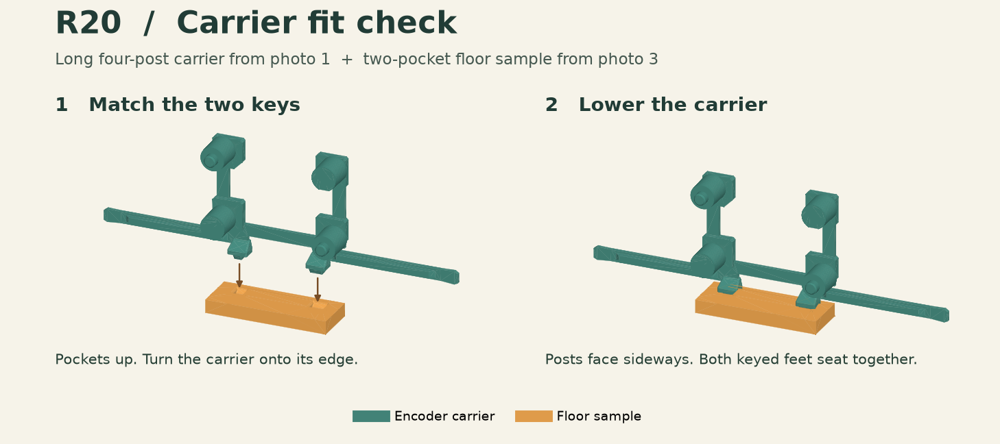

# R20 first physical print · 23 November 2026

**Removal and carrier-to-floor fit passed on this print.** The owner reported that nothing broke and that stringing was heavy. Fine strands run between parts and around the small features. The photos show one Bambu Engineering Plate. The layout and shapes match the eight-piece R20 first-article project. On 23 November the owner confirmed that the long four-post carrier fits the two-pocket floor sample. This is a qualitative fit result for one specimen. Rocking, seating force, measured dimensions and repeatability are unverified.

[Photo 1 · carrier and retainers](carrier-and-retainers.jpg) · [Photo 2 · thumbwheel](thumbwheel.jpg) · [Photo 3 · floor sample](floor-sample.jpg)

## Fit these two prints first

1. Snip loose strands clear of the pockets and feet. Preserve the printed edges. Lay the rectangle from photo 3 flat with its two recessed pockets up.
2. Take the long four-post carrier from the foreground of photo 1. Stand it on its long edge so the four posts point sideways. Find the two small keys between the long arm ends. Match the wider key to the wider pocket. Both arms extend beyond the rectangle.
3. Hold the center and lower both keys together under light fingertip pressure. The small shoulders around both keys should rest on the floor sample. Look from the side for a gap under one shoulder. Press gently over each foot in turn and check for rocking. Lift straight out and look for cracks or whitening. A forced or sanded fit would obscure the result.
4. Record whether both feet seat, whether it rocks and whether it comes out intact. If one side sits high, photograph the joint edge-on before modifying anything.

The drawing uses the released R20 carrier, floor mesh and installation transform. In CAD the key centers are 14.30 mm apart and the tips enter the floor sample by about 0.85 mm. These dimensions identify the intended mating features. [CAD geometry](../../build.py) · [First-article traveler](../../FIRST-ARTICLE.csv)

## Parts that need a mating component

| Printed part | Unpowered check |
|---|---|
| Four-post carrier | If available, offer the matching A2 sensor board or board dummy to its seats. The locating pins should line up and the board should lie flat. |
| Round thumbwheel in photo 2 | Inspect the raised hub and bore. Its spindle needs the matching housing or bearing fixture for a rotation check. A2 uses a contactless sensor facing the spindle magnet. Keep the wheel clear of the sensor chip. |
| Two small round keepers in photo 1 | Use the grip screw and receiver nut in their respective mating seats. The parts occupy adjacent locations on the released plate, with the grip screw keeper to the left of the nut keeper. |
| West key-board retainer, RGB diffuser retainer and RGB card retainer | Check each only with its matching board, card, diffuser or fixture. Inspect the ends for missing material after clipping loose strings. |

The next mating check, when the matching board or dummy is available, is the A2 sensor board on the carrier seats. Stringing remains a print-quality finding. Before a profile change, identify the spool material and selected preset. If repeating a stringing trial, keep the original R20 fit file and change one setting or material condition at a time.
