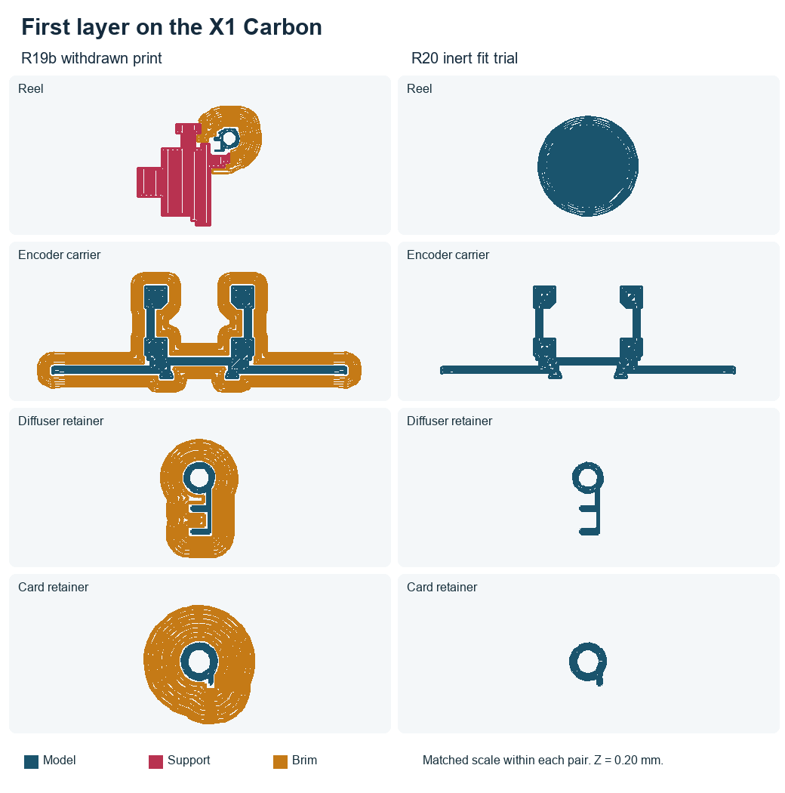

# R20 unpowered fit trial after R19b

**Start with the eight-piece [X1C first-article project](Print/Pocket-Reel-R20-First-Article-X1C.3mf).** It estimates **25 min 51 s and 5.08 g**. All eight parts print without a brim or generated support. The owner printed the first article and reported that every part came off intact, with heavy stringing. The owner also confirmed that the four-post carrier fits the two-pocket floor sample on this print. Board fit and repeatability await physical checks. [Print photos and illustrated fit instructions](QA/R20-first-print/README.md) The withdrawn R19b project and earlier R16 trial are separate configurations. The controlled R0012 electrical assembly has its own clearance and assembly evidence.

The owner identified **R19b** as the print that broke. Its recent-project entry names `Pocket-Reel-R19b-X1C-Fit-Test.3mf`. The recovered owner project is 3,556,292 bytes with SHA-256 `dcfc3c9c0725d91c54026f1e65f5b9855a036b35f61483d5b1dfcfb471db546c`. Its R19 datum-pocket housing, floor-key carrier and corrected cassette wall settings identify the revision independently of the filename. The project records 19 printable instances on four plates. The withdrawal identifies the rotor, carrier and small retainers for review. The earlier photograph of a housing fastener fracture during screw insertion has an unidentified boss and screw. The exact fractured feature and applied load for the R19b removal failure also remain unmeasured. [R19b withdrawal](https://github.com/natthapolvanasrivilai/thai-waters-handheld/issues/19) · [Earlier screw insertion fracture](https://github.com/natthapolvanasrivilai/thai-waters-handheld/issues/23)

## What changed

| Trial part | Change and fit evidence |
|---|---|
| Spring-free encoder thumbwheel | A closed thumbwheel prints front-face down. The R19b shaft, blind socket, insertion stop and rear shoulder are identical through original rotor X −4.75 mm. Symmetric mesh volume difference is zero over 391.06 mm³. The new turning surface stayed inside the R19b rotational envelope at 166 axial sections. This fixture exercises encoder seating and hand rotation. The folding reel, pivot action and spring remain separate development items. |
| Keyed encoder carrier | Each long arm gains a tapered 1.25 mm wide rib, adding 36.26 mm³ in total. At X ±12, ±15, ±20 and ±25 mm the section increases from 1.248 to 2.273 mm². The original floor keys, outside tab tips, four PCB seats and two locating pins retain their geometry. The ribs have zero overlap with the exact R19b shell. The full carrier and original carrier each show the same 0.000060 mm³ of tessellated contact. Actual stiffness and retention need a printed sample. |
| Housing floor sample | An 8 × 22 × 2.4 mm section taken directly from the R19b housing contains both asymmetric floor pockets. The revised carrier seats in this sample with zero nominal intersecting volume. It is a local mating gauge. Shell closure, USB baffle supports and electronics clearance require their own checks. |
| Five small parts | The grip screw keeper, receiver nut keeper, west key-board retainer, RGB diffuser retainer and RGB card retainer use their original meshes and interfaces. Their saved per-object brims are removed. Variable-width walls retain paths in the diffuser finger and upright card hook without forcing brim removal at their roots. |

The three original printable instances labelled proof-only or engineering-only have been removed from both the native build inventory and the packaged mesh resources. These were the rod grip, folding crank and spring cassette. The full housing under USB baffle review is represented by the floor sample only. The printed thumbwheel replaces the folding rotor solely for this fit trial. [Nominal dimensions and clearances](QA/nominal-fit.json) · [Exact before/after plate inventory](QA/native-projects.json)

## Toolpaths

| Part | R19b support / brim, mm³ | R20 support / brim, mm³ | R19b → R20 first-layer model contact, mm² |
|---|---:|---:|---:|
| Folding rotor → inert thumbwheel | 1,315.3 / 20.5 | 0 / 0 | 14.3 → 357.2 |
| Carrier | 0 / 113.1 | 0 / 0 | 255.9 → 256.1 |
| Diffuser retainer | 0 / 18.0 | 0 / 0 | 14.6 → 14.6 |
| Card retainer | 0 / 17.9 | 0 / 0 | 8.8 → 8.8 |

The R19b rotor had support extrusion on 109 layers. The R20 removal check counted model, brim and support roles in the native G-code and measured the first-layer union of model beads. Each first-article object has one connected bed footprint. Every subsequent connected component met the preceding model layer in the digital backing check. One 0.10 mm raster pixel on the carrier at Z3.80 mm prompted a polygon recheck of both layers. All four components were backed. This check measures contact somewhere on each component. It does not measure adhesion or certify every overhanging line. [Toolpath measurements](QA/removal-paths.json)



## Native files and profiles

| Editable project | Use | SHA-256 |
|---|---|---|
| [First article](Print/Pocket-Reel-R20-First-Article-X1C.3mf) | Eight charcoal PETG samples, one Engineering Plate. Start here. | `8633c456a0e7850894762848dbb211b10e7d92f7ae39ade2f3f2f308a3888059` |
| [Four-plate unpowered fit collection](Print/Pocket-Reel-R20-Unpowered-Fit-X1C.3mf) | 16 positions for a wider fit review. Includes the eight first-article parts plus the collar, wire bridge, bezel, knob, power cap, clear diffuser and two TPU parts. | `09578dd2571c70ef88761d1e78a51553615d56378bb6b450f2d8189e4e994f73` |

Bambu Studio **02.09.01.70** reopened and sliced both editable projects twice with the X1 Carbon 0.4 mm nozzle and 0.20 mm Standard process. All 16 collection positions and all eight first-article positions produced model paths through their expected heights, with zero native warnings and no material swaps on any plate. Eight local CAD-referenced windows passed 30 required layer checks, including both reinforced arms, both carrier locating pins, the encoder socket wall and both optical retainers. The native printer offset is X0/Y2 mm and is included in the witness registration. [First-article reopen evidence](QA/first-reopen-extrusion.json) · [Four-plate reopen evidence](QA/reopen-verified-extrusion.json)

The first-article file uses charcoal PolyLite PETG on the Engineering Plate. The collection uses separate plates for charcoal PolyLite PETG, teal PolyLite PETG, clear Generic PETG, and black Generic TPU 95A on the saved Cool Plate with external feed. The first three have the Engineering Plate saved. Existing supports on the wider collection's bezel and wire bridge require separate removal checks. The zero-support and zero-brim result applies to the first-article project. The saved print profiles are not an observation of the owner's actual spool, surface, firmware or machine calibration.

## Physical first article

1. Open the editable first-article file as a project. Confirm the X1C, 0.4 mm nozzle, actual charcoal PETG and matching Engineering Plate. Print on an unpowered bench workflow only after the owner chooses to run the physical test. Record the printer firmware, spool/lot, conditioning, plate preparation and any setting change. Keep a plate photograph before removal. The three changed STLs in `Print/` are provided for inspection; use the native file to preserve tested placements.
2. Let the flexible plate cool fully. With the plate removed from the machine, flex it gently away from the part over an empty tray. Support the carrier under its central frame and lift it with both arms free. Catch the small retainers by their solid rings or bases. The trial generates no support or brim to peel from a pin, hook, arm or encoder socket. If a part stays bonded, stop and record the affected spot before applying leverage. Retain loose fragments and photograph the corresponding first-layer location.
3. Inspect both carrier arms at the rib transitions, the four PCB seats and two pins. Lay the two floor keys over their matching asymmetric openings in the floor sample and lower the carrier straight onto the seat. Check for a stable seat, rocking, pin bending or stress whitening. Record arm thickness at midspan, post spacing and engagement. The sample isolates the two pockets and leaves the full shell and other installed hardware outside this test.
4. Seat the thumbwheel spindle by hand in the matching housing bearing or its dimensioned gauge. A2 senses the spindle magnet across an air gap. The original shaft outer envelope is 9.10 mm and the mouth envelope of its socket is 6.20 mm. Measure the actual shaft and socket, seating depth, rotation and any axial/radial play. Inspect for cracks at the shoulder and bore mouth. Use the intended dummy board or original datum reference for the carrier, and the original mating optical parts for the retainers. Record whether each keeper seats and releases with its hook or finger intact. Avoid forcing, drilling, sanding or adding adhesive to make a sample pass.
5. Repeat the removal and unpowered fit check on independently printed specimens before calling the result repeatable. Record dimension, cycle count, force or torque where measured and an after-photo for every failure. Keep the trial on hold after any incomplete path, damaged feature, permanent set, blocked fit or unresolved name/part mismatch. Powered operation, spring installation, qualified retention loads, long-term wear and production release require separate evidence. [Blank first-article record](FIRST-ARTICLE.csv)

## Reproduce the digital checks

Use Python 3.11 with lxml, NumPy, trimesh, manifold3d, SciPy, Shapely and Pillow. From this directory, generate the project from the withdrawn file with `python build.py <R19b.3mf>`. Native slices were run with separate output directories using the following invocation.

```text
bambu-studio --slice 0 --export-3mf sliced.3mf --outputdir <fresh-output-directory> <editable-project.3mf>
```

Keep each native `result.json`, `sliced.3mf` and `plate_N.gcode`. The `verify.py` report expects sibling run directories named `r19baseline`, `verified`, `reopen-verified`, `first-article` and `first-reopen`, respectively the original full slice, two new full slices and two one-plate slices. Run `python verify.py <R19b.3mf> <run-directory-parent>` and `python path_evidence.py <R19b-plate-1.gcode> <first-article-plate-1.gcode>`. The repository tool `tools/verify_model_extrusion.py` accepts the saved sliced 3MF and native JSON with `--features QA/feature-windows.json`. The final independently reopened sliced files and their native result files are included in `QA/`.
