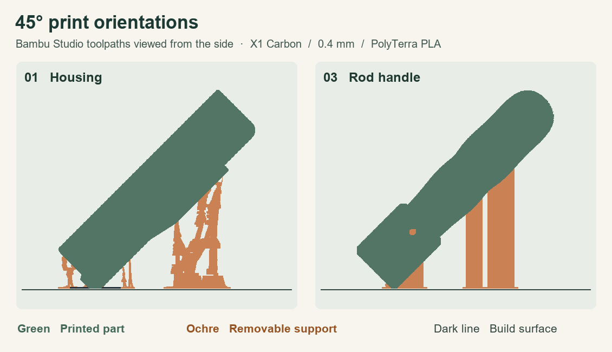

# R0006 angled enclosure fit print

[Open the editable Bambu Studio project](Thai-Waters-R0006-PolyTerra-SuperTack-X1C.3mf) · [Offline 3D assembly guide](Enclosure-fit-guide.html) · [First-article sheet for 27 parts](first-article.csv)

Print **plates 1 and 3** for the rod mount trial. Their orientations are saved. Plate 1 contains the sage housing and small status shelf. Plate 3 contains the sage detachable rod handle. On the X1 Carbon with a standard 0.4 mm nozzle the slicer estimates **55.59 g and 4 h 8 min** for plate 1, **29.50 g and 1 h 14 min** for plate 3, and **145.21 g and 8 h 33 min** for all eight plates. The project uses PolyTerra PLA throughout on Cool Plate SuperTack, 220 °C nozzle and 45 °C bed. Match the project color to the physical spool for each plate.

| Plate | Part and print orientation | What the slice shows |
| --- | --- | --- |
| 1 | Housing on its 45° rear bevel. The short shelf sits on its own base. | A continuous ramp roots the exterior of the grip receiver. Hybrid tree supports catch the small elevated starts and brace the open back. The housing uses 0.12 mm layers above its first layer. |
| 3 | Rod handle on the 45° corner of its mounting shoe. | Two removable support bands carry the palm section during the build. The bare shoe has 12.53 mm² of first-layer contact. Adding the two supports puts the projected center of mass 12.19 mm inside the combined footprint. |
| 2, 4–8 | Charcoal bezel and reel, white diffuser gauge, black rigid cover gauges, gray battery and PCB gauges, amber controls. | Each plate uses a single color. Each of the 27 parts in the project deposited from its first layer through its expected height in the combined slice and separate plate reopens. |

**USB wall review.** The two octagonal mouths flanking the inside of the USB-C well are unused. The upper one beside the two shelf posts served the former power-indicator light pipe (+Y). The lower one served the charging-indicator light pipe (−Y). The R0006 STEP and a section of the editable plate 1 mesh both retain these 1.44 mm bores. Their former exterior exits are closed. The current RGB indicator uses the central rectangular diffuser below USB. Leave the two mouths empty during the R0006 fit trial. Removing their internal sleeves while preserving the USB well and diffuser seat remains an open CAD correction.

### Changes at the receiver

Simply restoring the original diagonal orientation left a 37.14 mm strand floating at 31.4 mm build height. The added ramp carries that edge progressively on previous layers. It occupies 845.19 mm³ of extra material in the exterior shell and leaves at least 2.18 mm clearance to the grip throughout motion parallel to the slide. The toolpaths for the eight other elevated starts on the shell have measured interface backing. The support arrangement also clears the twelve checked openings, including the status light, power key, rear screw paths and bezel hook pockets. [Installed housing STEP](housing.step) · [Grip clearance](mount-check.json) · [Native slice and replay results](slice-review.json) · [Opening checks from the full slice](channels-full.json) · [Independent opening checks](channels-single.json)

### After printing

1. Let the plates cool. Support the housing in your hand while removing each tree branch from the outside or through the open case. Inspect the long receiver edge for lifted strands and the sloped backing for cracks.
2. Support the handle close to each contact band and remove the two saddles separately. Check the contact bands, mounting shoe, and through-hole for residual support.
3. With the case empty, slide the handle through its full travel, install the lock, release it, and withdraw it. Check for rubbing on the new ramp or whitening at the receiver root. Record any tight spot and how far the shoe traveled.
4. Fit the shelf, keyed button, diffuser and inert component gauges before closing the bezel. The white and black rigid PLA pieces check occupied space. Optical transmission, flexible cover retention, strength and energized operation require their intended materials and physical hardware.

The center-of-mass test uses the uniform-density mesh and the convex hull of the first-layer model, brim and support paths. It estimates tipping geometry. Bed adhesion, support release, surface finish and actual assembly fit still need a first article.

### Reproduce the review

Run `build.py` in the CAD environment to regenerate the editable project from the digest-checked R0005 archive. `receiver.py` exports the revised installed STEP. `fit_view.py` takes the registered assembly BREP directory and updates the viewer. Slice the editable project in Bambu Studio once with all plates and once per plate. Place those native results in `final0` through `final8`, then run `verify.py RESULT_DIRECTORY`. Run `channels.py PLATE_1_GCODE OUTPUT_JSON` on the full and independent slices. [Parent all-PLA process](../polyterra-fit-r0001/README.md)
