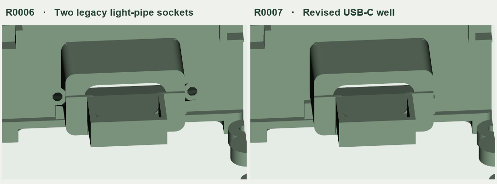

# R0007 single-light enclosure print

[Download the editable X1 Carbon project](Thai-Waters-R0007-PolyTerra-SuperTack-X1C.3mf) · [Interactive assembly guide](Enclosure-fit-guide.html) · [First-article sheet](first-article.csv)

For the next unpowered fit print, use **plate 1 for the housing and status shelf** and **plate 3 for the detachable handle**. If you already printed the R0006 handle, use it with this housing. Use plate 7 for the PCB and component gauges. All 27 parts use Polymaker PolyTerra PLA with the standard 0.4 mm nozzle and Cool Plate SuperTack. The saved project calls for 220 °C nozzle and 45 °C bed.

| Plate | Contents | Filament | Slicer estimate |
| --- | --- | --- | --- |
| 1 | Angled housing and status shelf | Sage | 55.54 g · 4 h 06 min |
| 2 | Bezel, rotor and retainers | Charcoal | 10.88 g · 40 min |
| 3 | Angled rod handle | Sage | 29.50 g · 1 h 14 min |
| 4 | Diffuser fit gauge | White | 0.38 g · 9 min |
| 5 | Rigid mask and cover gauges | Black | 0.87 g · 11 min |
| 6 | Battery gauges | Gray | 14.35 g · 34 min |
| 7 | PCB and component gauges | Gray | 32.54 g · 1 h 22 min |
| 8 | Reel controls and power cap | Amber | 1.10 g · 15 min |

The complete set totals **145.16 g and about 8 h 32 min**. Plate 1 is the only plate with a geometry change. Both the housing and handle have their saved 45° orientations. [Sliced side elevations](plate-key.png)

The two oblique charge and power light-pipe sleeves are gone, including their residual internal passages. The rectangular diffuser below USB serves the single RGB indicator. Three sections through the outer wall confirm one 2.50 × 2.00 mm status window in both the installed STEP and the editable print mesh. The USB connector, shield mask, lamp gauge, diffuser, shelf, speaker, bezel and rod grip have zero modeled interference with the revised shell. The diffuser, shelf and lamp installation paths also passed. [Housing STEP](housing.step) · [Interface measurements](interface-check.json) · [Insertion checks](light-motion.json)

Bambu Studio sliced all eight plates together and each plate after a separate reopen. All 27 parts deposited through their expected heights. Both housing slices cleared the twelve checked openings and had support beneath the elevated starts. [Slice report](slice-review.json) · [Full-project opening checks](channels-full.json) · [Separate plate 1 opening checks](channels-single.json)

After the plate cools, remove the exterior supports. Inspect both sides of the USB well, seat the diffuser and shelf, and try the USB connector and keyed power cap with the electronics unpowered. Slide, lock and withdraw the rod handle. Use the first-article sheet to record support release, surface finish and physical fit. The white and black rigid PLA gauges check shape. Optical transmission and flexible-cover retention require the intended materials.

Build the native project with `print_project.py`, then run `inspection.py` with the registered assembly BREP directory. Run `verify_release.py` on the directory containing the native full slice in `final0` and separate reopens in `final1` through `final8`. The [parent print record](../polyterra-fit-r0002/README.md) documents the receiver ramp and the handle support arrangement.
