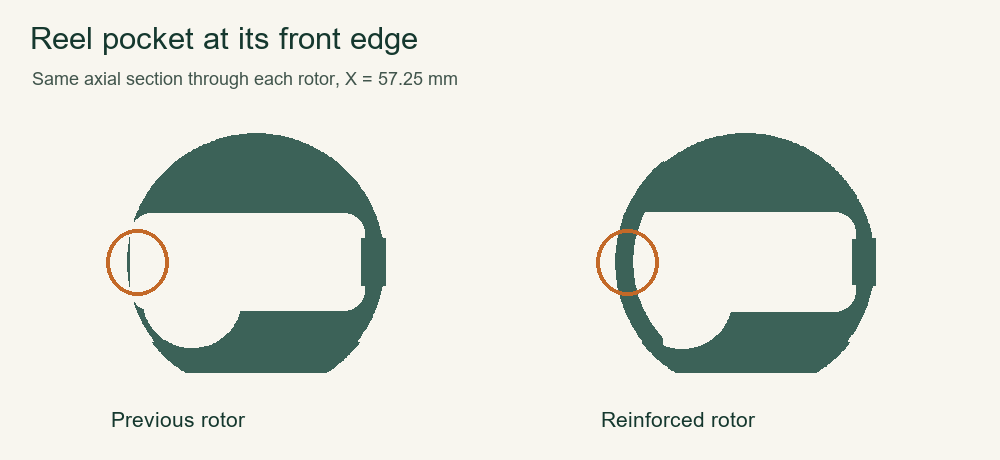

# Reel rim and seven-plate print review

**TW-A-0003-R0002 is an unpowered X1 Carbon fit-print kit.** The marked feature belongs to the rotating reel. Use the updated rotor on plate 2. Plate 3 also has a revised process for the removable rod grip. The kit includes the case-mounted combined PCB gauge, its matching housing and the keyed power cap. The older R0016 assembly animation shows the superseded rotor.

[Download the Bambu Studio project](https://github.com/natthapolvanasrivilai/thai-waters-handheld/releases/download/reel-dfm-r0001-fit-1/Thai-Waters-DFM-R0001-X1C.3mf) · [Download the offline section and part inspector](https://github.com/natthapolvanasrivilai/thai-waters-handheld/releases/download/reel-dfm-r0001-fit-1/Print-inspection.html) · [View the complete per-part inspection table](inspection.csv) · [Rotate the print mesh on GitHub](rotor.stl) · [Installed rotor STEP](rotor.step)

## What changed

| Feature | Earlier print definition | Current print definition |
|---|---|---|
| Crank-pocket end | 0.50 mm radial wall near the middle. The front radius breaks through. | Concentric pocket end with a 1.85 mm radial wall and a 1.50 mm minimum at the front bevel. Same outside diameter and shaft interfaces. |
| Model deposition across that end | At build Z 7.60 mm the marked line has no deposited plastic. At Z 10.20 mm it has about 0.49 mm. | 1.68 mm and 1.84 mm at the same witnesses. An independent reopen and reslice repeated all 28 local measurements. |
| Rod grip | A 0.156 mm² patch starts at Z 34.0 mm with no model or support below it. | The print uses 0.10 mm layers between 32.8 and 35.2 mm. All 664 model layers were checked. The freestanding start disappears. |

Only the end of the crank pocket gains material (136 mm³). Over the 90° fold the conservative clearance between the added material and the closest moving feature, the grip screw, is 0.579 mm. A full-revolution envelope clears the housing by 0.350 mm, the bezel by 0.430 mm and the three added board supports by at least 11.05 mm. Printed tolerances, pin fit and wear need a physical check. [Geometry](rotor-geometry.json) · [Motion measurements](fold-and-spin.json) · [Before and after native toolpaths](local-paths.json)

## Review of every part

Bambu Studio 02.09.01.70 sliced the saved X1 Carbon project with the 0.4 mm nozzle. The project carries PETG, clear-part PETG and TPU profiles. [Per-plate settings and G-code fingerprints](slice-record.json)

The saved seven plates contain 17 device pieces, two alternative battery gauges and seven PCB gauges. All 26 meshes are single closed positive-volume bodies. All 26 produce model paths from their expected first to last layer. The inspector lists each object's bed contact, brim, support, model layers, isolated starts, sampled side-wall thickness, shallow undersides and handling check. It separates material actually printed from support and brim. [Full per-part table](inspection.csv) · [Native model layer checks](deposition.json) · [Bed contact and model backing](part-paths.json) · [Mesh and thickness results](thickness.json)

| Priority for the next inert print | What the audit found | Acceptance check |
|---|---|---|
| Housing, plate 1 | At Z 14.20 mm a 17.00 mm² shelf starts over removable support. The closest measured supporting layer at Z 13.80 mm overlaps 8.12 mm² of model footprint. | Clear the USB-end support in pieces. Check the shelf survives, the indicator can be inserted and the receiver slides freely. |
| Rotor, plate 2 | The strengthened end is continuous. At the opposite end a 2.89 mm² strip still starts over support at Z 10.40 mm. The projected overlap is only 0.008 mm² at Z 10.00 and 1.90 mm² at Z 9.80. | Remove the recessed support while backing the rim with a finger. Inspect both ends for peeling, splits and sag. Fold and open the crank, then turn it one full revolution in both positions. |
| Folding stem and light guides, plates 2 and 4 | The stem starts on 2.91 mm² of model contact with a brim. The three guides also use brims. Two guides have sampled sides near 0.84 mm. | Cut the brim in sections with the part supported. Inspect the stem eye and guide bends. Test hinge fit and optical continuity. |
| Power cap, USB mask and service cover, plates 2 and 5 | The cap has small face/flange details. The flexible USB mask is 0.51 mm tall and prints flat in three layers. The service cover has a thin retaining edge. | Check key return, peel the mask from its broad edge and inspect the webs, then fit a real USB plug. Check cover retention after removal. |
| Board and battery gauges, plates 6 and 7 | All nine gauge bodies slice. The smallest USB board gauge is only 3.2 × 2.0 mm. The display gauge has broad underside spans. | Catch small gauges in a tray. Check the display underside for sag, measure the gauges, then trial them in the empty case. |

The side-wall survey casts 18,000 repeatable inward rays per object and records opposing surfaces. Low readings can occur at chamfers, lettering and tapered tips. The fifth percentile is a screening measurement. The marked rotor wall also has a separate dimensional and deposited-path check. The underside area counts elevated downward triangles below 30° from horizontal. The layer audit detects whole model islands without overlap on the preceding model layer. None of these measurements establishes bond strength, breakaway force, bridge sag or a slicer-independent minimum wall. The two remaining support starts are open first-article items.

## Reproduce the inspection

1. Use CadQuery, trimesh, python-fcl, VTK, Shapely, Pillow and SciPy with Python 3.11. Run `rotor.py`, then `project.py`. Run `motion.py PATH_TO_REGISTERED_BREP_DIRECTORY` using the registered solids extracted by the [case-board fit workflow](../../electronics/case-board-r0001/README.md).
2. Slice the saved seven-plate project in Bambu Studio into a directory named `all`. Reopen the saved project in a clean process and independently slice plate 2 into `reopen`. Slice plates 2 and 3 of the original R0016 project into `before` and `oldrod` respectively. Each directory needs its native report, sliced archive and exported plate G-code. Use the saved materials, nozzle, plate and object settings.
3. Run `tools/verify_model_extrusion.py all/sliced.3mf all/result.json` from the repository and save its JSON as `deposition.json` in this folder. From this folder run `paths.py PATH_TO_ALL`, `thickness.py`, `witness.py PATH_TO_PARENT_OF_THE_FOUR_RUNS` and `report.py`. Inspect the generated sections and every row. The report contains the planned first-article observations, awaiting an actual print of this revision.

The newest electrical and hardware qualification records remain in the [handbook](../../../docs/wiki/Current-status.md). This print review makes no change to the circuit or its outstanding bench tests.
