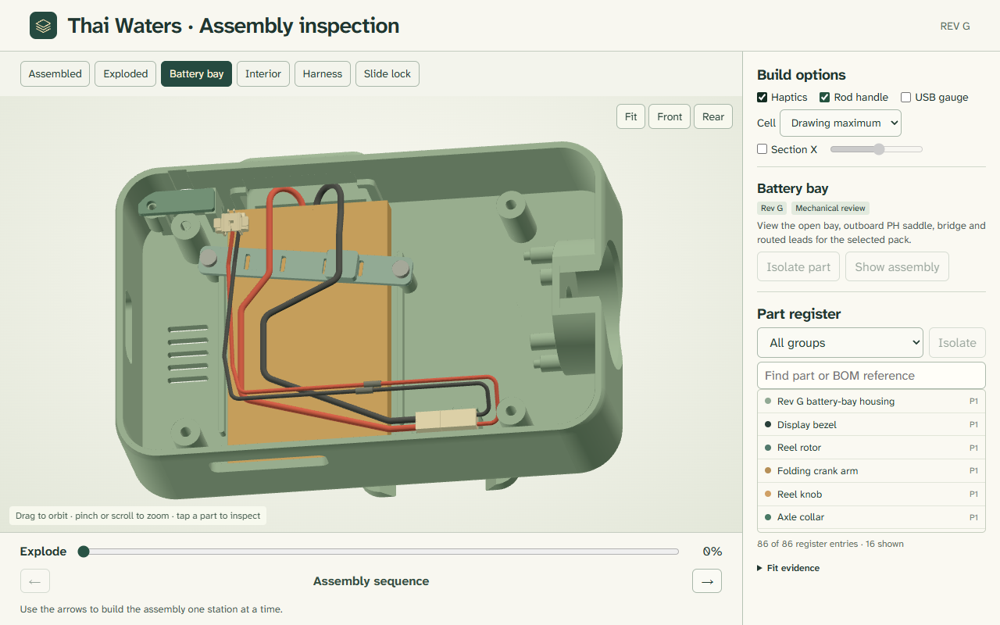

# Rev G battery fit print

**Print the housing, west-side key-board retainer and lift-out wire bridge together.** These are the three changed prints. Reuse the other nine parts from a Rev F set. For a first build, the kit contains all twelve device STLs plus two separate inert battery gauges. The top-left cap, switch PCB, folding reel and grip interface retain their positions.

[Private print kit](https://github.com/natthapolvanasrivilai/thai-waters-handheld/releases/download/rev-g-fit-print/Riffle-Rev-G-fit-print.zip) · [Offline 3D viewer](https://github.com/natthapolvanasrivilai/thai-waters-handheld/releases/download/rev-g-fit-print/Riffle-Rev-G-exploded.html) · [Dressed assembly STEP](https://github.com/natthapolvanasrivilai/thai-waters-handheld/releases/download/rev-g-fit-print/Riffle-Rev-G-dressed.step.gz)

## What changed

The cell center in the assembly frame is X −10.40, Y −0.65 mm, with the pack base at Z 3.60 mm. Two low side fences and two mounting lands locate it. A locally rounded lead tunnel at the top adds 5.20 mm to the housing’s Y extent. The housing STL is 108.50 × 74.25 × 31.00 mm. The local tunnel roof and floor each measure 2.00 mm at the reported section. Its end wall measures 1.95 mm. These are local measurements.

The factory PH plug and adapter sit in a dedicated saddle outboard of the pouch. The design preserves each 100 mm factory lead, including 3 mm of modeled molded projection on the supplier STEP variant. Both wires turn outward at 4.2 mm centerline radius. The remaining factory-lead bends use a 3 mm radius. Select a pack under **Battery bay** in the viewer to see the matching route. Assumed insulation diameters are 1.4 mm for the pack leads and 0.9 mm for the adapter. Confirm the received wire and its allowed bend radius. The removable bridge supports the two leads on separate heights and has tape slots. The adapter splice sleeves sit on the straight return run. The cut list records finished connector-to-connector centerline lengths in routes.json under batt0 and batt1. Establish the splice cut positions and termination allowance on the actual matched pigtails before trimming.

## Before installing a live pack

1. Slice in millimetres at 100%. Check the STL dimensions in [the print manifest](print-manifest.json). Keep supports removable around the tunnel, grip shoe and key guides. Clear the two blind pilot holes and deburr the lands, bridge slots and wire exit. Measure both inert gauges after printing.
2. Install the receiver nut/keeper and the top-left power key. Use the **west-side retainer** and the existing H6 keeper screw. Cycle the cap. Leave the display and the removable wire bridge off.
3. Use thin shims to represent the intended 0.50 mm mounting material on the two lands. Lower the drawing-maximum gauge from above, then repeat with the supplier-CAD gauge including its protection cap and stubs. Each must seat level and lift out without forcing it. Record gauge dimensions, material, slicer profile and any witness marks.
4. Use insulated dummy leads for the first fit. Form outward return bends in the relief, feed slack toward the PH saddle, then install the bridge with **two M2 × 4 mm screws**. Loop thin insulating tape through the slots and around the dummy leads. Keep both connector faces accessible, splice sleeves clear of the cell, and tape off the pouch. Check screw hold in the printed 1.6 mm pilots and that the bridge lifts out cleanly.
5. Fit the controller and bezel over the inert pack and dressed harness. Inspect for pinch, bridge deflection, cap drag and marks after reopening. Measure the received protected cell, insulation, lead exit, mating orientation and any supplier-required life-cycle allowance before approving a powered closure. The 0.65 mm bridge clearance is a geometric result, not a qualified swelling allowance.

## CAD acceptance

| Check | Result |
|---|---|
| Catalog 34 × 62 × 5 mm, drawing maximum 35.3 × 62.3 × 5.3 mm and alternate supplier CAD 37 × 63 × 6 mm overall | 2,486 relevant component pairs per configuration. Zero unresolved intersections above 0.002 mm³ in each. |
| Open-shell installation and withdrawal | Continuous vertical bounding prisms for every pack solid, checked against the housing, installed key hardware and specified floor components. Zero interference for all three configurations. Bridge and controller install afterward. |
| Placement margin | Sixteen drawing/STEP pose corners with ±0.25 mm in X and Y and 0 or +0.30 mm height. Zero housing or bridge overlap. |
| Drawing maximum to bridge / closest PH body | 0.65 mm / 6.75 mm. |
| Alternate CAD to bridge / closest PH body | 0.95 mm / 5.98 mm. Both packs have 0.50 mm to the mounting lands. |
| Power key and screw stack | Fifteen positions from 0 to 0.70 mm, with zero cap interference against housing or retainer. All three affected screw envelopes clear the housing above their intended pilot engagement. |
| Print geometry | Twelve single-component, watertight, positive-volume device STLs. Bounding dimensions and SHA-256 hashes accompany each. |

The seated test includes every pair involving a changed part or a previously added review component, including wire-to-wire checks. The ledger identifies mating contacts and inherited contacts individually. It does not re-test internal contacts inside a bought module. [Collision ledger](collisions.json) · [Sweeps, gaps, wall sections and offsets](qualification.json) · [Wire paths](routes.json) · [Part register](parts.json) · [Assembly BOM changes](fit-bom.csv)

## Reproduce

Use CadQuery 2.8, NumPy and trimesh in Python. Start from the Rev F dressed STEP archive and offline viewer in the [prior private engineering pack](https://github.com/natthapolvanasrivilai/thai-waters-handheld/releases/tag/rev-f-engineering-0.7). Also place the prior release handbook HTML in that export directory to rebuild the private handbook. The generators verify their SHA-256. Run from the repository root, with the two extracted Rev F exports in the export directory. Use a fresh scratch directory.

~~~powershell
python hardware/mechanical/rev-G/build.py --exports ../outputs --work ../work-g
npm --prefix verification/browser-tests ci
$env:NODE_PATH=(Resolve-Path verification/browser-tests/node_modules).Path
npx --yes --package esbuild@0.25.0 esbuild hardware/mechanical/rev-F/review/viewer.js --bundle --minify --format=iife --outfile=../work-g/renderer.js
python hardware/mechanical/rev-G/pack_view.py --exports ../outputs --work ../work-g
node verification/browser-tests/rev-g-fit.cjs ../outputs/Riffle-Rev-G-exploded.html ../outputs/Riffle-Rev-G-battery-bay.png
python hardware/mechanical/rev-G/handbook.py --exports ../outputs
python hardware/mechanical/rev-G/postflight.py --exports ../outputs --work ../work-g
~~~

Use the printed inert assemblies to establish actual manufacturing tolerance, thermal movement, retention and wire wear. Rev F electrical verification and open charging-protection work remain applicable.

