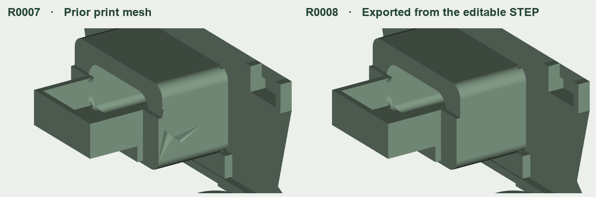

# R0008 housing from editable STEP

[Editable housing STEP](housing.step) · [Bambu Studio project](Thai-Waters-R0008-STEP-PolyTerra-SuperTack-X1C.3mf) · [Interactive assembly guide](Enclosure-fit-guide.html) · [First-article checks](first-article.csv)

Print **plate 1** for the corrected housing and status shelf. The R0006 and R0007 rod handles use the same mount. Plate 3 contains the angled handle if needed, and plate 7 contains the inert PCB and component gauges. The saved X1 Carbon project uses the standard 0.4 mm nozzle, Polymaker PolyTerra PLA, and Cool Plate SuperTack at 45 °C with a 220 °C nozzle. The housing retains its 45° print orientation and the single status diffuser.

### Source and correction

The previous print pipeline edited the USB flank a second time in a separate mesh. That left eight inward-facing triangles across the two USB side faces. The drawing geometry in the editable STEP was sound. We rebuilt the housing from the [pre-optical editable STEP](../polyterra-fit-r0002/housing.step), replayed the two sleeve removals as solid-model operations and saved the resulting housing as the master above. It contains one closed solid with planar and curved CAD faces.

The print exporter opens that saved STEP, tessellates the complete housing and applies the saved build orientation. The housing uses a 35° tree-support branch angle and a 0.23 mm support-to-part XY gap. The eight plate layouts, support-blocker shapes and other 26 parts carry forward. Edit the STEP for subsequent housing changes, then run `housing_project.py` to regenerate the print project. The explicit `--rebuild-master` option recreates this revision from its historical solid inputs.

### Verification

- The released 3MF contains the same 90,392 triangles as a fresh tessellation of the master. Both USB flanks have zero inward-facing triangles and zero measurable overlap. The complete housing is watertight with zero non-manifold edges. [Face and provenance checks](face-check.json)
- On each side, 63 sampled layers fully covered a strip inside the USB wall and left the adjacent outside strip clear of housing material. The combined slice and independent plate 1 reopen gave the same result. [USB wall toolpaths](wall-paths.json)
- All 27 parts passed in the full eight-plate slice and individual plate reopens. Twelve opening checks cover the diffuser, key, rear screw paths and bezel hooks. Plate 1 is estimated at 54.66 g and about 4 h 02 min. [Slice report](slice-review.json) · [Full-project openings](channels-full.json) · [Independent openings](channels-single.json) · [Side elevations](plate-key.png)
- The installed dimensions match the intended R0007 solid. The USB connector, mask, shelf, diffuser, RGB gauge, speaker, bezel and handle clear the housing in CAD. The checked diffuser, shelf and lamp insertion sweeps also clear. [Installed interfaces](interface-check.json) · [Assembly motions](light-motion.json)

After cooling and support removal, inspect the flat walls beside the USB well, seat the mask and diffuser, and check the fit with the device unpowered. Surface finish, support removal and physical fit await the first article.
